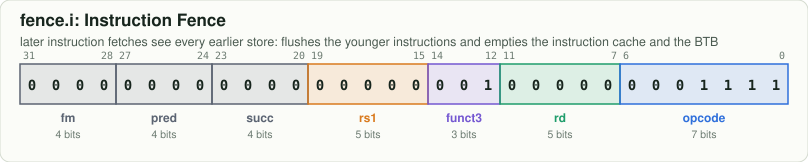
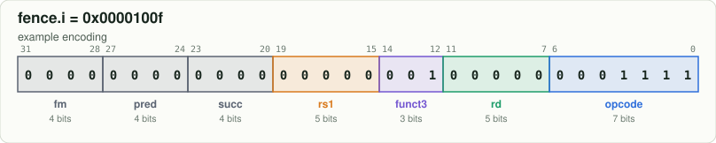

# `fence.i`: Instruction Fence

[← all instructions](../README.md) · extension **Zifencei** · format **FENCE** · category *System*

```
later instruction fetches see every earlier store: flushes the younger instructions and empties the instruction cache and the BTB
```

## Encoding



```
bit:  31                              0
      0000 0000 0000 0000 0001 0000 0000 1111
```

Fixed bits are `0`/`1`. Letters are filled in by the assembler:
`d` = rd, `s` = rs1, `t` = rs2, `i` = immediate, `h` = shift amount, `c` = CSR address, `z` = 5-bit CSR immediate, `f` = funct3, `m/p/u` = fence fields.

## Example

`fence.i` assembles to **`0x0000100f`** = `00000000000000000001000000001111`



| field | bits | template | example |
|---|---|---|---|
| `fm` | 31:28 | `0000` | `0000` |
| `pred` | 27:24 | `0000` | `0000` |
| `succ` | 23:20 | `0000` | `0000` |
| `rs1` | 19:15 | `00000` | `00000` |
| `funct3` | 14:12 | `001` | `001` |
| `rd` | 11:7 | `00000` | `00000` |
| `opcode` | 6:0 | `0001111` | `0001111` |

Try it yourself:

```bash
node tools/rv.mjs encode "fence.i"
node tools/rv.mjs decode 0000100f
```

## Control signals from the Control Unit ([`src/Control_Unit.sv`](../../src/Control_Unit.sv))

These are the exact values the RTL produces for the example word above (computed by the
bit-exact twin in `model/core.js`, which `make test` checks against the RTL every cycle).

| signal | value | | signal | value |
|---|---|---|---|---|
| `REGISTER_WRITE_ENABLE` | `0` | | `IS_A_MULTIPLY_DIVIDE_INSTRUCTION` | `0` |
| `MEMORY_READ_ENABLE` | `0` | | `IS_A_BRANCH_INSTRUCTION` | `0` |
| `MEMORY_WRITE_ENABLE` | `0` | | `IS_A_JAL_INSTRUCTION` | `0` |
| `CSR_WRITE_ENABLE` | `0` | | `IS_A_JALR_INSTRUCTION` | `0` |
| `CSR_WRITE_USING_IMMEDIATE` | `0` | | `IMMEDIATE_TYPE_SELECT` | `IMMEDIATE_I` |
| `ALU_INPUT_A_IS_PC` | `0` | | `WRITEBACK_SELECT` | `WRITEBACK_ALU` |
| `ALU_INPUT_B_IS_IMMEDIATE` | `0` | | `ALU_OPERATION` | `ALU_XXX` |
| `ALU_IS_WORD_OPERATION` | `0` | |  |  |

## Journey through the 6-stage pipeline

| stage | what happens to `fence.i` |
|---|---|
| **FETCH1** | The PC is sent to the instruction memory. At the same time the **GSharePredictor** reads the 2-bit counter at `PC[5:2] XOR GLOBAL_HISTORY_REGISTER` (it does not know yet what instruction this is). |
| **FETCH2** | The 32-bit word arrives from memory. It is not a branch or JAL, so fetching simply continues at `PC + 4`. |
| **DECODE** | **ControlUnit** + **ALUdec** recognise `fence.i` from opcode `0001111`, funct3 `001`; the **ImmediateGenerator** builds the I-type immediate. No registers are needed. |
| **EXECUTE** | FENCE.I acts here, like a trap: it flushes FETCH1, FETCH2 and DECODE (3 bubbles), empties the instruction cache and the BTB, and FETCH1 restarts at `PC + 4`, so every later instruction is fetched again from memory, after every earlier store (the data cache writes through). The deep-pipeline edition does the same at M1. |
| **MEMORY** | No memory work. **WriteControl** picks the result value. |
| **WRITEBACK** | Nothing to write. The instruction retires (`instret` + 1). |

See the whole datapath in the [block diagram](../../docs/ARCHITECTURE.md) and step through a program in the [web simulator](../../web/index.html).
