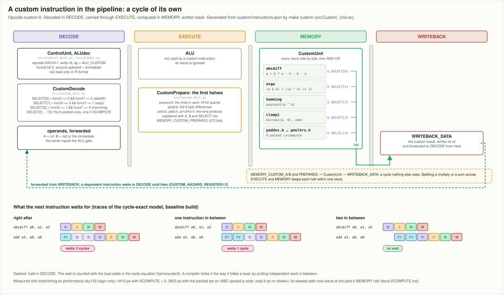

# Your own instructions

RISC-V is designed to be extended. The specification reserves four major opcodes for instructions that
are not, and never will be, standard: `custom-0` to `custom-3`. Sixfold uses `custom-0` (`0001011`) for
instructions you design. You describe one in a line of JSON (JavaScript Object Notation); Sixfold's tools give it an encoding, teach
it to the assembler, the disassembler and the pipeline model, generate the SystemVerilog, and check the
hardware against the model on every clock cycle.

* Try it in the browser: the [instruction workshop](../web/custom.html), or the "Invent an
  instruction" section of the [front page](../index.html#workshop).
* Learn it step by step: [chapter 11](learn/11_custom_instructions.md).
* The four that ship with Sixfold: [`custom/instructions.json`](../custom/instructions.json), used by
  [`programs/23_custom_instructions.s`](../programs/23_custom_instructions.s).

## One instruction, one line

```json
{ "name": "absdiff", "format": "R", "funct3": 0, "funct7": 0, "expr": "a > b ? a - b : b - a",
  "desc": "Absolute difference (unsigned)" }
```

| field | meaning |
|---|---|
| `name` | the mnemonic, 1 to 16 lowercase letters, digits or dots. It cannot be a standard instruction or an assembler pseudo-instruction (`li`, `mv`, ...) |
| `format` | `R`: `name rd, rs1, rs2` (two registers). `I`: `name rd, rs1, imm` (a register and a 12-bit signed immediate, -2048 to 2047) |
| `funct3` | R format: 0 to 3. I format: 4 to 7. Bit 2 of funct3 is how the unchanged decoder knows which format it is |
| `funct7` | R format only: 0 to 127. Together with funct3 it selects one of 512 R-format slots; the I format has 4 slots |
| `expr` | what goes into `rd` (below) |
| `desc` | a sentence for the documentation and the workshop |

The encoding is a normal RISC-V R- or I-type word with opcode `0001011`:

```text
R:  funct7[31:25]  rs2[24:20]  rs1[19:15]  funct3[14:12]  rd[11:7]  0001011
I:  imm[31:20]                 rs1[19:15]  funct3[14:12]  rd[11:7]  0001011
```

`absdiff a0, a1, a2` (funct3 0, funct7 0) assembles to `0x00c5850b`.

## The expression language

All values are 64-bit unsigned and arithmetic wraps, exactly like the hardware. `a` is rs1; `b` is rs2
(R format) or the sign-extended immediate (I format, also called `imm`). `rs1` and `rs2` work as names too.

| | |
|---|---|
| arithmetic | `+` `-` `*` (the low 64 bits), unary `-` |
| bits | `&` `\|` `^` `~`, shifts `<<` `>>` (logical) `>>>` (arithmetic); a shift amount uses its low 6 bits |
| comparisons | `==` `!=` `<` `<=` `>` `>=` (unsigned), giving 1 or 0; `slt(x, y)` and `sltu(x, y)` |
| logic | `!` `&&` `\|\|` (any nonzero value is true), `c ? x : y` |
| functions | `min` `max` (signed), `minu` `maxu`, `abs`, `clz` `ctz` `popcount`, `rev8`, `rotl` `rotr`, `bit(x, n)`, `sext8` `sext16` `sext32`, `zext8` `zext16` `zext32` |
| numbers | `42`, `-7`, `0xff`, `0b1010`, `1_000_000` |

Division, remainder and memory access are deliberately missing: a divider takes many cycles (see the M
extension in [ARCHITECTURE.md](ARCHITECTURE.md)), and the data cache is busy with loads and stores in
the cycle where custom logic runs.

## From JSON to hardware

```bash
# 1. edit custom/instructions.json (or design in web/custom.html and press Download JSON)
make custom               # writes src/Custom_Unit.sv and model/custom_spec.js
make test                 # every program on the RTL and the model, compared on every cycle
make custom-check         # 60 random instructions using every operator and function, RTL against model
```

`make custom SPEC=my.json` builds another file. `node tools/custom.mjs --print` shows the module
without changing anything; `--check` (used by continuous integration) fails if the generated files are
out of date.

What happens inside:

1. [`model/custom.js`](../model/custom.js) parses each expression into a tree and checks the set:
   names, formats, free slots.
2. The tree is compiled twice: to a JavaScript function for the model (`compileJS`) and to a
   SystemVerilog expression for the hardware (`toVerilog`). A comparison becomes `{63'd0, (A < B)}`;
   anything that needs bit selects (`clz`, `sext8`, a shift by a variable amount) calls a small function
   that the generator writes into the module once.
3. [`tools/custom.mjs`](../tools/custom.mjs) writes `src/Custom_Unit.sv`, two modules:
   `CustomDecode` turns funct3 and funct7 into one select bit per instruction (in DECODE), and
   `CustomUnit` computes every instruction's result side by side and keeps the selected one with an
   AND-OR (in MEMORY). An unused encoding selects nothing and gives 0.
4. [`model/isa.js`](../model/isa.js) registers the instructions at start-up, so the assembler, the
   disassembler, the documentation generator and the pipeline model know them.

The hardware around `Custom_Unit.sv` never changes:

| file | what it does for custom-0 |
|---|---|
| `src/Opcode_pkg.sv` | `OPC_CUSTOM0 = 7'b0001011` |
| `src/Control_Unit.sv` | writes rd; the second operand is the immediate when funct3 bit 2 is set; rs2 is read only in R format (so a stall is never a false alarm) |
| `src/ALUdec.sv` | `ALU_CUSTOM`: the operands pass through DECODE unprepared |
| `src/Riscv64.sv` | DECODE runs `CustomDecode`; EXECUTE registers the two operands (the same ones the ALU gets) and the select bits; MEMORY runs `CustomUnit`, whose result goes straight into `WRITEBACK_DATA`; `CUSTOM_HAZARD_REGISTER1/2` hold a dependent instruction in DECODE until then |

## Where the custom logic runs, and why



A clock cycle has to be long enough for the slowest piece of logic between two pipeline registers.
Sixfold's tightest loop is ALU, then forwarding, then ALU again (an `add` whose result the very next
instruction needs), and its EXECUTE→MEMORY path is so full that even `cpop` is split across two stages
(`src/Population_Count.sv`). Custom logic placed there would set the clock of the whole processor.

So a custom instruction's operands are only registered in EXECUTE, and its logic runs in MEMORY, where
it has the cycle to itself: from the operand registers, through `CustomUnit`, into `WRITEBACK_DATA`, a
path nothing else uses. The result is ready in WRITEBACK, from where it is forwarded like any other
value. An instruction that needs it waits in DECODE: two cycles if it comes right after, one with an
instruction in between, none with two. `programs/23_custom_instructions.s` shows both cases: the `add`
three instructions after `absdiff` waits for nothing, the `add` right after `clampi` waits two cycles.
The cycle equation counts those waits with the load stalls.

## What fits in a cycle

Measured with `make timing` (logic only, SkyWater 130 nm, typical corner; the same flow as
[PERFORMANCE.md](PERFORMANCE.md)). The flow's results move by about 0.3 ns from run to run for the same
design, so only the column "slowest path starts at" says for certain whether the custom logic is the
limit.

| design | logic delay | slowest path starts at |
|---|---|---|
| no custom instructions | 3,877 ps (258 MHz) | the core (`EXECUTE_REGISTER2_DATA`) |
| first attempt: all four in EXECUTE, popcount as a 64-step chain | 5,046 ps (198 MHz) | the custom logic |
| the same, popcount and leading zeros as trees | 4,390 ps | the custom logic |
| now: all four in MEMORY, without `hamming` | 3,899 ps | the core |
| now: all four in MEMORY, popcount as a 16-operand sum | 4,219 ps | the custom logic (popcount) |
| now: all four in MEMORY, popcount as a carry-save tree | 4,045 ps (247 MHz) | the custom logic, within the run-to-run spread |
| **now: `+`, `-`, comparisons, `min` / `max` on prefix adders; `max(x, 0)` as a sign test** | **3,832 ps (261 MHz)** | the custom logic (`hamming`), level with the core without custom instructions |

The last row is a change to the generator, not to the instructions. Written as a plain `x + y`, Yosys
builds a 64-bit ripple-carry adder (every bit waits for the carry from the bit below it). The generator now
writes `+`, `-`, `<`, `>` (and `min`, `max`, `minu`, `maxu`, `slt`, `sltu`, `abs`, which are built on them) as a
prefix adder: the carries are combined in pairs, then fours, then eights, 6 levels for 64 bits. A signed
`min`, `max` or `slt` against the constant 0 needs no adder at all, only the sign bit, so `clampi` now has one
comparison instead of two. Measured on the custom unit alone with the same flow (inputs to output, no
registers):

| custom unit alone | SkyWater 130 nm | ASAP7 7 nm-class |
|---|---:|---:|
| before (plain `+`, `-`, `>`, `$signed(x) < $signed(y)`) | 4,066 ps | 540 ps |
| after (prefix adders, sign test against 0) | 3,521 ps | 484 ps |

`avgu` alone went from 2,355 ps to 1,651 ps at 130 nm. What was left was `hamming`: 3,504 ps alone, and three
other ways of writing a 64-bit popcount (a sum of 64 bits, four 16-bit quarter sums, a tree of pairwise sums)
all measured 3,577 ps to 3,901 ps, so the carry-save tree was already the fastest of the four. A popcount is
mostly XOR gates, and no way of writing it fits in one cycle beside everything else.

So the generator now splits it across two stages, as the ALU does for `cpop` (`src/Population_Count.sv`).
`CustomPrepare`, in EXECUTE, computes the argument of each `popcount` (the first 3 in the set) from the
registered operands and counts its ones in four 16-bit quarters; the counts travel to MEMORY with the operands
(`MEMORY_CUSTOM_PREPARED` in `src/Riscv64.sv`), where `CustomUnit` only adds the four. No cycle changes.
Measured on ASAP7, inputs to output: `CustomUnit` 484 ps before, 357 ps after; `CustomPrepare` 249 ps.
`make custom-check` runs random instruction sets through both halves against the model.

Three lessons, the same ones every processor designer meets:

* **Where logic sits matters as much as what it is.** Moving it out of EXECUTE gave it a cycle of its own.
* **Structure beats cleverness.** A 64-bit popcount written as a chain of additions is 64 adders deep; as
  a tree it is 6. A carry-save tree goes further: every layer of full adders turns three numbers into
  two without waiting for a carry, and only the last addition carries.
* **Compute side by side, then choose.** `min(max(a, 0), imm)` compares, chooses, then compares again;
  checking the inputs directly (`slt(imm, a) || slt(imm, 0) ? imm : slt(a, 0) ? 0 : a`, the same
  function) needs one comparison's time. The workshop's depth meter estimates this for every expression.

## The four examples, measured

On the performance build (`make run PROG=23_custom_instructions` prints the same numbers):

| task | plain RV64I | with the custom instruction |
|---|---|---|
| sum of absolute differences of 8 pairs | 179 cycles (a compare, a branch and a subtract each) | 83 cycles with `absdiff` |
| Hamming distance of two 64-bit words (34 bits differ) | 181 cycles (clear the lowest 1 bit until none are left) | 13 cycles with `hamming` |
| clamp a pixel to 0 ... 255 | two compares and two branches, or `max` and `min` with Zbb | one `clampi` |
| average of two numbers near 2<sup>64</sup> | `(a + b) / 2` overflows; the fix takes 4 instructions | one `avgu` |

Real instruction sets grew the same way, one measured workload at a time: x86's `PSADBW` (sum of
absolute differences, for video, 1999) and `POPCNT` (2008), ARM's saturating `QADD`, and RISC-V's own
Zbb (`cpop`, `min`, `max`) and Zicond (`czero.eqz`, which the workshop offers as an idea) extensions.

## Designing a good one

* **It must earn its encoding.** Measure the program with and without it (`rdcycle` before and after, as
  program 23 does). An instruction that saves a cycle in code that runs once is not worth a slot.
* **One cycle of logic.** An add, a compare, a few multiplexers or a bit count fit; two of them one
  after the other do not. The workshop's depth meter estimates the longest path in adder delays (the
  budget is about 1.5). A 64 x 64 multiplier does not fit in one cycle at Sixfold's clock on silicon; a
  real design would make it take several cycles, as the M extension does.
* **Two inputs, one output.** That is what the register file and the forwarding paths provide. Three
  inputs (a multiply-add) would need a third read port, which is a much bigger change.
* **Name it like RISC-V would.** Short, lowercase, a `.w` or `.b` suffix for word or byte variants.

## Limits

* At most 32 custom instructions, in the 512 R-format and 4 I-format slots of custom-0.
* No memory access, no branches and no state of their own (a custom instruction is a pure function of
  rs1 and rs2 or the immediate).
* The other three custom opcodes, and the 48-bit and longer instruction encodings RISC-V also reserves,
  are left for further labs: [EXPERIMENTS.md, Lab 25](EXPERIMENTS.md#lab-25-design-an-instruction-for-a-real-workload).
