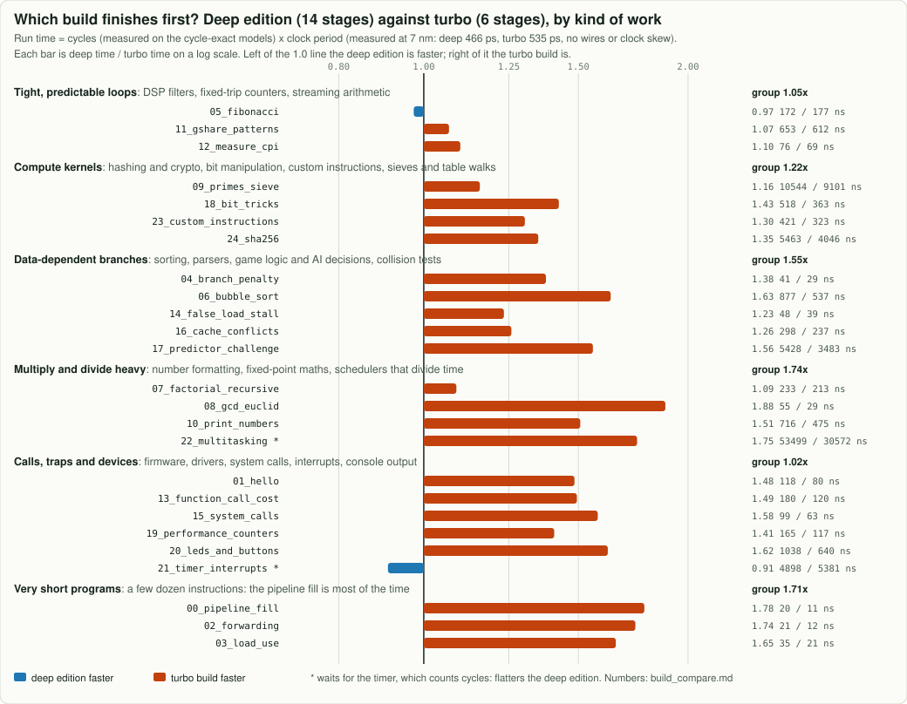
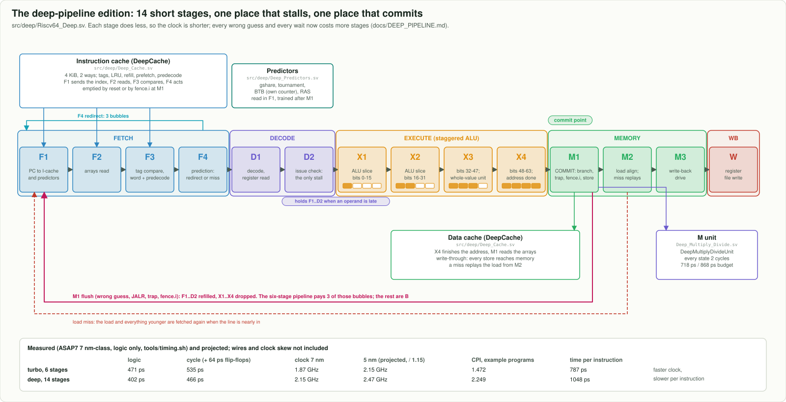

# The deep-pipeline edition: 14 stages for a higher clock

The deep-pipeline edition is a separate build of Sixfold, in its own files ([`src/deep/`](../src/deep),
[`model/deep.js`](../model/deep.js), [`tb/riscv64_deep_testbench.sv`](../tb/riscv64_deep_testbench.sv)). It runs
the same programs with the same results as the other builds, and it answers one question: how far can the
clock go if every stage is made short, and what does that cost in CPI (cycles per instruction)?

The other builds are unchanged. The deep edition shares the leaf modules (adders, the register file, the
control unit, the predictor tables) and keeps everything of its own in `src/deep/`.

Every number below is labelled:

* **measured**: produced by a tool in this repository, which you can run again;
* **projected**: a measured number scaled by a published factor;
* **assumed**: an estimate that no tool here produces.

## The result

| | turbo build (6 stages) | deep edition (14 stages) |
|---|---:|---:|
| logic on the slowest path, ASAP7 7 nm-class (measured, `tools/timing.sh <build> asap7`) | 471 ps | 402 ps |
| cycle with the flip-flops' 63.7 ps (measured logic + flip-flop data from the ASAP7 library) | 535 ps | 466 ps |
| clock at 7 nm, no wires or clock skew | 1.87 GHz | **2.15 GHz** |
| clock at 5 nm (projected: ÷ 1.15, the published N5 over N7 speed gain) | 2.15 GHz | **2.47 GHz** |
| CPI, the 25 example programs (measured, `make deep-check`) | 1.472 | 2.249 |
| CPI, the 8 test programs (measured) | 2.337 | 4.396 |
| time per instruction, example programs, at 7 nm | 787 ps | 1048 ps |

The deep edition's clock is 15% faster, and its CPI is 53% higher on the example programs. Per instruction it
is about **33% slower** than the turbo build. This is the honest result of the experiment: on these programs,
the extra stages cost more cycles than they win back in clock.

ABC (the logic synthesis tool) does not give the same number twice for equivalent circuits: on two versions of
the RTL (register-transfer level code) that differ only in how a signal is written, it reported 369 ps and
402 ps. The table reports the final run; read the deep edition's logic as **369 to 402 ps** (2.15 to 2.31 GHz
at 7 nm).

What is and is not included in the timing:

* **Included:** the whole core and the logic of both caches (tags, LRU, refill, prefetch, predecode).
* **Black-boxed:** the cache SRAMs (static random-access memory arrays, `DeepCacheArray`, which a memory
  compiler would build), the multiply/divide unit (timed on its own, below) and the custom-instruction chain.
  For each black box, the arrival times at its inputs and outputs were checked as well, so no one-cycle path
  hides behind it.
* **Not included:** wire delay and clock skew. On a real chip they take 10 to 20% of the cycle (assumed).

## Which build for which work

[`make compare`](../tools/compare_builds.mjs) runs every example program on both models and turns cycles into time
with each build's measured clock period (turbo 535 ps, deep 466 ps at 7 nm). The programs are grouped by the
kind of work they stand for; the grouping is a judgement, the cycles and periods are measured.



| kind of work | stands for | deep time / turbo time (measured) |
|---|---|---:|
| tight, predictable loops | DSP filters, fixed-trip counters, streaming arithmetic | 1.05 |
| calls, traps and devices | firmware, drivers, system calls, interrupts | 1.02 * |
| compute kernels | hashing and crypto, bit manipulation, custom instructions | 1.22 |
| data-dependent branches | sorting, parsers, game logic, collision tests | 1.55 |
| multiply and divide heavy | number formatting, fixed-point maths, schedulers | 1.74 |
| very short programs | a few dozen instructions | 1.71 |
| **all 25 example programs** | | **1.51** |

\* This group contains `21_timer_interrupts`, whose wait is counted in clock cycles (the machine timer ticks once
per cycle in both builds), so on the faster deep clock it waits less time. With a timer on a fixed clock the
group would come out worse for the deep edition. `22_multitasking` waits for the same timer.

The deep edition finishes first on one program, `05_fibonacci` (0.97), where nearly every instruction is an
independent add and the loop branch is always guessed right. Everywhere else the turbo build is faster: every
wrong guess costs the deep edition 10 stages instead of 3, a whole-value dependency waits longer, and a multiply
or divide takes twice as many short cycles. Measured as time to finish the same programs, the deep edition takes
1.51 times as long; the per-instruction figure in the table above (1.33) is smaller because `22_multitasking`
retires extra idle-loop instructions while it waits for the timer.

**Recommendation.** For general software, games, parsers, firmware and anything with multiply or divide, use the
six-stage turbo build. The deep edition only pays off for long runs of independent, well-predicted arithmetic,
and even there it only ties; it is the build to study what a faster clock costs, not the faster computer.
For a chip where area matters more (HYDRA-130 on SkyWater 130), the compact build (the performance edition
with 1 KiB caches, `CACHE_SETS = 16`) is the one tested there.

## The 14 stages

```text
F1 F2 F3 F4 D1 D2 | X1 X2 X3 X4 | M1 M2 M3 | W
```



| stage | work | cache beside it |
|---|---|---|
| F1 | the program counter (PC) goes to the instruction cache and the predictor tables | instruction cache |
| F2 | the arrays are read | instruction cache |
| F3 | the instruction-cache tag compare; both ways' words and predecode are registered | instruction cache |
| F4 | the prediction: a JAL, a branch guessed taken or a return sends F1 to its target (3 bubbles); a miss restarts F1 at this PC and waits for the line | instruction cache |
| D1 | decode, register file read | |
| D2 | the issue check: holds F1 to D2 when an operand is not ready in time. **The only stage that stalls** | |
| X1..X4 | the staggered ALU (arithmetic logic unit): one 16-bit slice per stage, low slice first | |
| M1 | **the commit point**: branches and JALR resolve, traps are taken, `fence.i` flushes and empties the instruction cache and the BTB, loads look up the data cache, stores and CSR (control and status register) writes happen, multiply/divide starts | data cache |
| M2 | load alignment | data cache |
| M3 | the write-back drive | |
| W | the register file write | |

Nothing behind D2 ever stalls: the back end moves one stage every cycle. That is what keeps each of its loops
inside one short stage. A load that misses does not hold the pipeline; it is fetched again from F1 when its
line is nearly in ("replay").

### The staggered ALU

`tools/clock_floor/staggered_alu.sv` shows the idea alone: an add does bits 0 to 15 in X1, 16 to 31 in X2,
and so on, passing the carry along. A dependent add can start one cycle later, because it also needs only the
low slice first. That is how a deep pipeline keeps back-to-back adds at one per cycle with a 16-bit loop
instead of a 64-bit one. Instructions that need the whole value at once (shifts, Zbb, store data,
multiply/divide operands) wait for it: the issue check in [`model/deep.js`](../model/deep.js) lists, for every
producer, the stage where its whole result exists, and for every consumer the stage where it needs it.

### The multiply/divide unit: `DeepMultiplyDivideUnit`

[`src/deep/Deep_Multiply_Divide.sv`](../src/deep/Deep_Multiply_Divide.sv) is the deep edition's own unit. Every
state takes **two cycles**, so its paths have a two-cycle budget (2 x 466 - 64 = 868 ps):

* the first state only latches the raw operands (nothing computed on the way in from M1);
* a multiply is one 64 x 64-bit carry-save step;
* a divide is radix 16: 4 quotient bits per step, made of two radix-4 iterations, where the second iteration
  is computed for all four possible first digits at once and one is picked when the first finishes.

| path | logic (measured, `tools/timing.sh deep-mdu asap7`) | budget |
|---|---:|---:|
| `DeepMultiplyDivideUnit` alone | 718 ps | 868 ps (two cycles) |

The cycle count is `2 x steps + 4`, where steps is 1 for a multiply (+1 for a negative operand that matters) and,
for a divide, 1 (align) + ceil((quotient bits) / 4) + 1 for each negative operand and remainder fix-up
(`deepMultiplyDivideSteps` in [`model/deep.js`](../model/deep.js)).

## Where the caches sit

The instruction cache sits beside F1 to F4: F1 sends the index, F2 reads the arrays, F3 compares the tags and
F4 acts on the result. The data cache sits beside X4 and M1: X4 finishes the address and M1 reads the arrays,
with the hit, the alignment and the write-back spread over M1 to M3. Each cache's tag and data arrays are
placed next to the stage that reads them, so no stage carries a long wire from one side of the core to the
other. (This is a planned floorplan, not a placed and routed one; chapter 13 of the learning path shows the
same plan for the turbo build.)

Four changes made the cache logic itself fit in the cycle, without changing which line is kept or refilled
(the model and the RTL still agree on every cycle):

* the replacement victim is chosen one cycle ahead and stored in a register;
* the next line to prefetch is stored in a register;
* each tag probe is split into two steps: the row is read and the line being installed is merged a cycle
  early, and only the compare happens in the cycle itself;
* the data cache's LRU (least recently used) bit is updated one cycle after the access.

## The cycle equation

The deep edition has the same exact cycle equation as the other builds ([MATH.md](MATH.md#2-exact-cycle-count)):

```text
cycles = N + 5 + L + 3 * F + R + K + I + D + X + B
```

Each event is charged what it would cost in the six-stage pipeline, and **B** counts the bubbles that exist only
because the pipeline is deeper: the rest of a flush's refill, dependency waits longer than the six-stage
pipeline's, and the prediction bubbles of F4. Every bubble is tagged with its cause at W, so the equation holds
exactly: `make math` checks it on every program, predictor on and off.

A miss costs 12 cycles (assumed memory latency): 12 x 466 ps = 5.6 ns is at least the turbo build's 10 x 535 ps,
so the deep edition is not given a faster memory than the turbo build.

## Why not 5 GHz

5 GHz at 5 nm is a 200 ps cycle, about 230 ps at 7 nm, so at most about 166 ps of logic per stage. The deep
edition is at 402 ps. Three things stand between them:

1. **The floor.** The smallest loop a single-issue pipeline must close in one cycle, a 16-bit adder slice plus
   its bypass, is 183.5 ps on its own (measured, `make clock-floor`). With synthesized standard cells, no
   pipeline depth reaches 166 ps; that takes hand-built circuits or a dependent instruction waiting a cycle.
2. **The wall.** After the changes above, many different paths end between about 375 and 400 ps (estimated
   from path reports): the performance counters, the BTB's training, the refill and prefetch addresses, the
   tag-probe latches, F4's redirect from the back end, the predecode write. Each needs its own stage or its
   own redesign; there is no single culprit left.
3. **The CPI cost.** Every stage added before the commit point adds bubbles to every wrong guess and every
   dependent instruction. At CPI 2.249 against 1.472, a clock would have to be 53% faster just to break even.
   The multiply/divide unit alone is about a third of the example programs' cycles (most of them in
   `22_multitasking`).

A real 5 GHz core closes that gap with out-of-order execution, which hides the extra latency behind
independent instructions, and with custom circuits. Both are outside the scope of this in-order, synthesized
design.

## Run it

```bash
make test                         # all five builds, the deep edition included: RTL against model/deep.js, every cycle
node tools/test.mjs --config=deep # the deep edition only
make compare                      # run time against the turbo build, by kind of work (the chart above)
make deep-check                   # its CPI against the turbo build, and why it held, program by program
tools/timing.sh deep asap7        # the core with its cache logic
tools/timing.sh deep-mdu asap7    # DeepMultiplyDivideUnit alone, against its two-cycle budget
```
