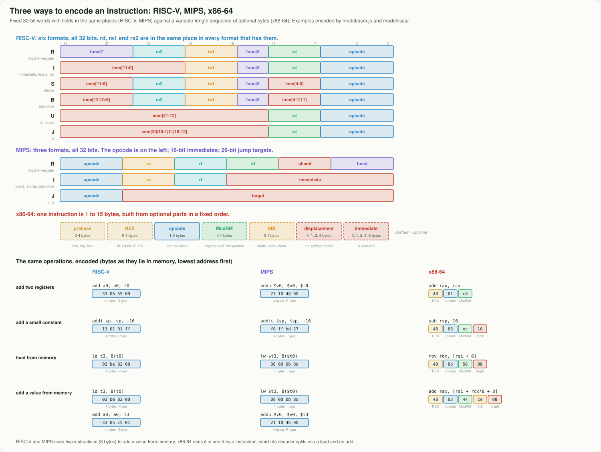
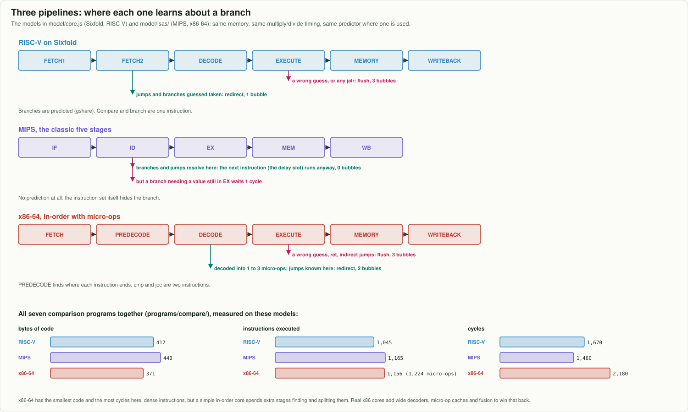

# Three instruction sets: RISC-V, MIPS and x86-64

Sixfold's hardware runs RISC-V. To show what that choice means, the repository also has models of two
other instruction set architectures (ISAs): **MIPS32** (Microprocessor without Interlocked Pipelined
Stages, the classic teaching architecture) and a subset of **x86-64** (the architecture of most desktop
and server processors). Seven programs are written in all three, assembled to real machine code, and
run cycle by cycle on a pipeline model typical of each architecture.

* Try it: [the three-architecture lab](../web/isa.html) (switch with the RISC-V / MIPS / x86-64 buttons),
  or the "One program, three instruction sets" section of the [front page](../index.html#isa).
* Learn it: [chapter 10 of the learning path](learn/10_three_architectures.md).
* Check it: `make isa-check` (every encoding and every run against independent tools, below).

RISC-V is still the only architecture in the hardware; MIPS and x86-64 exist only in the models.

## The rules that make the comparison fair

The three pipelines differ in the ways their instruction sets force them to. Everything else is the same:

| | all three |
|---|---|
| memory | ideal: every access takes one cycle (no caches), byte addressed, little-endian |
| multiply and divide | Sixfold's iterative unit: busy for the same number of cycles for the same operands |
| branch predictor | Sixfold's baseline gshare (4 bits of global history) where the pipeline predicts |
| program layout | code at `0x2000`, the character output device at `0x10000000` |
| what counts | from reset to the halt instruction (`csrrwi zero, tohost, 1`, `break`, `hlt`) leaving the pipeline |

RISC-V runs on the Sixfold model itself (`model/core.js`, the baseline configuration with the iterative
multiplier), the same model that is checked against the SystemVerilog.

## Encoding

| | RISC-V | MIPS | x86-64 |
|---|---|---|---|
| instruction length | 4 bytes (2 with the C extension, not used here) | 4 bytes | 1 to 15 bytes |
| formats | R, I, S, B, U, J | R, I, J | prefixes, REX, opcode, ModRM, SIB, displacement, immediate |
| registers | 32 x 64-bit, `x0` is always 0 | 32 x 32-bit, `$zero` is always 0; HI and LO for multiply/divide | 16 x 64-bit, plus a flags register |
| memory operands | loads and stores only | loads and stores only | almost any instruction can read or write memory |
| conditional branch | compares two registers itself (`blt a0, a1, L`) | `beq`/`bne` compare two registers; anything else needs `slt` first | `cmp` sets the flags, then `jcc` tests them |
| function call | `jal` writes the return address to a register | `jal` writes `$ra` | `call` pushes it on the stack |

**RISC-V** keeps `rd`, `rs1` and `rs2` in the same bit positions in every format, so the register file can
be read before the instruction is fully decoded. The cost is immediates scattered in pieces (the B and J
formats), which costs only wires.

**MIPS** puts the opcode on the left and has just three formats. It is the design RISC-V learned from.
Its 16-bit immediates are larger than RISC-V's 12-bit ones, which is why MIPS code is sometimes shorter.

**x86-64** builds an instruction from optional parts. The REX byte (register extension: `W` for 64-bit
operands, `R`, `X`, `B` for registers 8 to 15) exists because the original 8086 had only 8 registers.
The ModRM byte (mode, register, register/memory) names one register and one register-or-memory operand.
The SIB byte (scale, index, base) adds `[base + index*scale]` addressing. Some combinations have special
meanings: `rsp` or `r12` as a base always needs a SIB byte, and `rbp` or `r13` with no displacement means
"no base", so the assembler emits a zero displacement byte. The encoder in `model/isas/x86.js` handles
these cases, and every form it emits is byte-for-byte identical to the GNU assembler's.

## Pipelines

| | RISC-V on Sixfold | MIPS | x86-64 |
|---|---|---|---|
| stages | FETCH1 FETCH2 DECODE EXECUTE MEMORY WRITEBACK | IF ID EX MEM WB | FETCH PREDECODE DECODE EXECUTE MEMORY WRITEBACK |
| branches | predicted; guessed-taken redirect costs 1 cycle, a wrong guess or `jalr` costs 3 | resolved in ID; the delay slot always runs, so 0 cycles | jumps known in DECODE: 2 cycles; a wrong guess, `ret` or an indirect jump: 3 |
| what the decoder does | one instruction per cycle | one instruction per cycle | finds where the instruction ends (PREDECODE), then splits it into 1 to 3 micro-ops, one per cycle |
| cycle equation | N + 5 + L + F + R + K | N + 4 + L + B + H | U + 5 + L + F + R + K + S |

The letters: N instructions, U micro-ops, L load-use stalls, F flush bubbles, R redirect bubbles,
K multiply/divide busy cycles, B cycles a MIPS branch waits for an operand still being computed,
H cycles `mfhi`/`mflo` wait for the multiply/divide unit, S cycles x86 FETCH loses when an instruction
crosses a 16-byte fetch block. Each model checks its own equation after every run.

The MIPS **branch delay slot** is the most striking difference. Because MIPS resolves branches in ID, the
instruction right behind the branch has already been fetched; instead of throwing it away, the
architecture says it always runs. The assembler (or the programmer: the programs here use
`.set noreorder`) puts useful work there. A branch costs nothing, without any predictor. The price came
later: once pipelines got deeper or wider, one delay slot no longer hid the branch, but every MIPS
processor still had to honour it. RISC-V deliberately has none.

The x86-64 **micro-ops** are how real x86 processors run a complex instruction set on simple execution
units. `add rax, [rsi + 8]` becomes a load micro-op and an add micro-op; `push rbx` becomes a store and an
update of `rsp`; `ret` becomes a load, an update of `rsp` and an indirect jump. The model's micro-op
counts are in `microOps()` in `model/isas/x86.js`.

## Results

Measured by `make isa-compare` (the same numbers as the lab and the front page). Each cell is
RISC-V / MIPS / x86-64.

| program | bytes of code | instructions executed | cycles | cycles per instruction (CPI) |
|---|---|---|---|---|
| array_sum_max | 64 / 72 / 58 | 69 / 90 / 77 (87 micro-ops) | 93 / 113 / 142 | 1.35 / 1.26 / 1.84 |
| bubble_sort | 112 / 124 / 112 | 291 / 362 / 325 | 531 / 474 / 686 | 1.82 / 1.31 / 2.11 |
| factorial_recursive | 76 / 84 / 53 | 116 / 134 / 80 (138 micro-ops) | 239 / 177 / 259 | 2.06 / 1.32 / 3.24 |
| fibonacci | 44 / 40 / 37 | 155 / 155 / 154 | 192 / 189 / 251 | 1.24 / 1.22 / 1.63 |
| gcd | 36 / 44 / 41 | 19 / 27 / 26 | 73 / 72 / 87 | 3.84 / 2.67 / 3.35 |
| hello | 48 / 48 / 43 | 91 / 93 / 91 | 131 / 127 / 146 | 1.44 / 1.37 / 1.60 |
| sum_to_100 | 32 / 28 / 27 | 304 / 304 / 403 | 411 / 308 / 609 | 1.35 / 1.01 / 1.51 |

What the numbers say:

* **x86-64 code is the smallest** (371 bytes in total against 412 and 440): one instruction can load and
  add, push and call fold several steps into one, and small constants take one byte.
* **x86-64 executes the fewest instructions only when memory operands help** (factorial_recursive: 80
  instructions, but 138 micro-ops). Where they do not, `cmp` plus `jcc` makes every loop one instruction
  longer (sum_to_100: 403 against 304).
* **MIPS has the fewest cycles here.** Its delay slots make taken branches free, and resolving branches in
  ID is cheap in a 5-stage pipeline. Sixfold's baseline build pays 1 cycle per predicted-taken branch
  (sum_to_100: R = 99) because it finds branches in FETCH2; the performance build's Branch Target Buffer
  makes those 0 cycles (the comparison leaves it out so that no model has a predictor the others lack). MIPS pays instead when a branch needs a value still being computed
  (B = 72 in bubble_sort) and in instruction count, since it has no `blt` (`slt` + `bne`) and no 64-bit
  registers.
* **The simple x86-64 pipeline is the slowest.** Every jump costs 2 cycles because it is found in DECODE,
  instructions that cross a 16-byte block cost a fetch cycle (S = 88 in bubble_sort), and multi-micro-op
  instructions hold DECODE. Real x86 processors win this back with branch target buffers that redirect in
  fetch, several decoders, a micro-op cache, fusion of `cmp`+`jcc` into one micro-op, and a stack engine
  that tracks `rsp` in the front end. [EXPERIMENTS.md Lab 24](EXPERIMENTS.md#lab-24-teach-the-x86-64-model-a-real-processors-tricks) adds two of these.

None of this says one instruction set is "best": these are three simple in-order pipelines, and a
different microarchitecture would change every column. What stays true is what each instruction set
makes easy or hard for the hardware: fixed fields for fast decode (RISC-V, MIPS), delay slots that help a
5-stage pipeline and hinder every later one (MIPS), and dense, variable-length code that needs a
predecoder and a micro-op translator (x86-64).

## How it is checked

| check | what it compares | command |
|---|---|---|
| encodings | every x86-64 instruction form the assembler emits, against the GNU assembler (`as`), byte for byte | `make isa-check` (when `as` for x86-64 is installed) |
| meaning | every comparison program runs on Unicorn (the CPU emulation of QEMU, written independently): all registers and the printed output must match our model | `make isa-check` |
| lengths | Capstone (an independent disassembler) decodes each instruction to the length our assembler gave it | `make isa-check` |
| results and timing | each program's `# RESULT:` and `# OUTPUT:` lines, and each pipeline's cycle equation | `make isa-check` (runs `tools/isa_test.mjs`) |

Unicorn does not implement RISC-V's B extension, so `array_sum_max` (which uses `max`) is skipped there;
the RTL regression and `tests/isa_selfcheck.s` check those instructions on Sixfold itself.

## Files

| file | what it is |
|---|---|
| `model/isas/asm_common.js` | the shared two-pass assembler: labels, directives, expressions |
| `model/isas/mips.js`, `mips_core.js` | the MIPS32 assembler, decoder and 5-stage pipeline |
| `model/isas/x86.js`, `x86_core.js` | the x86-64 subset assembler, decoder, micro-op splitter and pipeline |
| `model/isas/index.js` | one interface over all three (`ARCHS`), and `measure()` |
| `programs/compare/{riscv,mips,x86}/` | the seven programs, written for each |
| `web/isa.html`, `web/isa.js` | the three-architecture lab |
| `site/isa.js` | the front page section |
| `tools/isa_dump.mjs`, `tools/isa_crosscheck.py`, `tools/isa_test.mjs` | the checks above |

The x86-64 subset is the 64-bit integer instructions the programs need: `mov`, `movzx`, `lea`, the eight
classic ALU operations, `test`, `inc`, `dec`, `neg`, `not`, `mul`, `imul`, `div`, `idiv`, `cqo`, shifts,
`push`, `pop`, `call`, `ret`, `jmp`, `jcc`, `setcc`, `cmovcc`, `nop` and `hlt`, in NASM-style Intel syntax.
The manuals are listed in [REFERENCES.md](REFERENCES.md#instruction-set-manuals).
