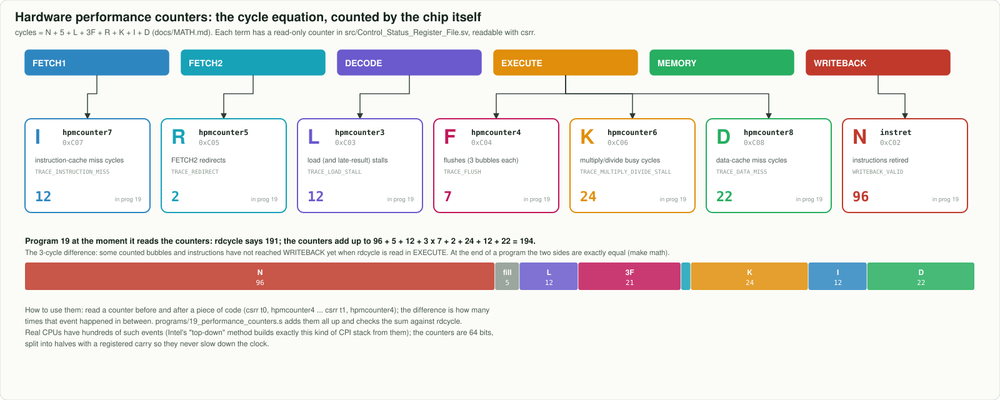

# The math behind the pipeline

Every formula here is checked by a tool in this repository.

## 1. Iron law of performance

```text
time = instructions x CPI x clock period          (Patterson and Hennessy, ch. 1)
```

For the original chip, 1 / 26 ns = **38.5 MHz**. A program with CPI 1.3 then executes
38.5 / 1.3 = 29.6 million instructions per second.

## 2. Exact cycle count

```text
cycles = N + (S - 1) + L + P * F + R + K + I + D + X + B
       = N + 5       + L + 3 * F + R + K + I + D + X + B
```

| symbol | meaning | source in the RTL | hardware counter |
|---|---|---|---|
| N | instructions retired | `WRITEBACK_VALID` | `instret` (0xC02) |
| S | stages = 6; the first instruction needs 6 cycles, so S - 1 = 5 fill bubbles | | |
| L | load stalls (loads, the 2-cycle Zbb results, a Zbs single-bit operation whose bit number was just computed, and in the turbo build an M result used right away), 1 bubble each | `LOAD_STALL` | `hpmcounter3` |
| F | flushes: wrong branch guesses + JALR misses + traps + `fence.i`, P = 3 bubbles each | `FLUSH_FETCH1_FETCH2_DECODE` | `hpmcounter4` |
| R | FETCH2 redirects whose bubble survives, 1 each (taken branches found in the BTB cost 0 and are not counted) | `FETCH2_BRANCH_OFF_OR_CONTINUE` | `hpmcounter5` (every redirect) |
| K | cycles the iterative M unit holds EXECUTE (performance build: multiply 7, divide 4 + dividend bits; turbo build: multiply 3, divide 2 + ceil((dividend bits - divisor bits + 1) / 2) (at least 3), + 1 for a negative operand or remainder, see [PERFORMANCE.md](PERFORMANCE.md#fastmultiplydivide-a-separate-unit-fastmultiplydivideunit)) | `MULTIPLY_DIVIDE_STALL` | `hpmcounter6` |
| I | bubbles sent to FETCH2 while the instruction cache refills | `icache_hit` | `hpmcounter7` |
| D | cycles a load waits in EXECUTE for its data-cache line | `DATA_CACHE_STALL` | `hpmcounter8` |
| X | interrupts taken: the pseudo-instruction that replaced a DECODE instruction never retires, 1 bubble each (its flush is already in F) | `EXECUTE_IS_AN_INTERRUPT` | `hpmcounter9` |
| B | turbo build only (`LATE_BRANCH_RESOLVE`): a wrong branch guess or JALR target is acted on one cycle later, from MEMORY, and the instruction then in EXECUTE is removed too: 1 bubble on top of the flush's 3 (0 when EXECUTE held a bubble) | `LATE_FLUSH && EXECUTE_VALID` | `hpmcounter10` |

**The deep-pipeline edition** ([DEEP_PIPELINE.md](DEEP_PIPELINE.md), 14 stages) uses the same equation: each
event is charged what it costs in the six-stage pipeline, and B counts every bubble that exists only because the
pipeline is deeper (the rest of a flush's refill, a dependency wait longer than the six-stage pipeline's, the
prediction bubbles of its fourth fetch stage). Every bubble is tagged with its cause when it reaches W, so
`make math` checks the equation exactly for this build too. Its M unit holds for `2 x steps + 4` cycles, where a
step is one 64 x 64-bit multiply or 4 quotient bits of a divide (`deepMultiplyDivideSteps` in
[`model/deep.js`](../model/deep.js)).

**Why 3 for a flush:** when EXECUTE flushes, FETCH1, FETCH2 and DECODE all hold wrong-path
instructions. They are replaced by bubbles, and the correct instruction starts in FETCH1 on the next
cycle, reaching EXECUTE 3 cycles after the branch left it.

**Why a late branch costs 4:** the turbo build stores the branch's outcome in the MEMORY pipeline register
instead of flushing straight from the comparator. One cycle later the flush clears FETCH1, FETCH2, DECODE (3,
counted in F) and EXECUTE (1, counted in B). The comparator then feeds only flip-flops, so the path from the
branch compare to the next-PC multiplexer and every front-end enable is gone from the clock.

**Why an interrupt costs 4:** the interrupt replaces the instruction in DECODE with a pseudo-instruction
that traps in EXECUTE. Its flush squashes FETCH1, FETCH2 and DECODE (3 bubbles, counted in F), and its own
slot never retires (1 more, X). The replaced instruction is not lost: `mepc` points at it, and it runs
after `mret`. [`programs/21_timer_interrupts.s`](../programs/21_timer_interrupts.s) takes 25 timer
interrupts, and [`tests/interrupt_stress.s`](../tests/interrupt_stress.s) takes 388, on every kind of
instruction. Both are cycle-exact against the RTL, and the checksum comes out the same as without
interrupts.

**Why only surviving redirects:** a redirect bubble sitting in FETCH2 or DECODE when a flush happens is
overwritten, so it is counted inside the flush's 3. The model tags every bubble with its cause and
counts them as they reach WRITEBACK, so the equation is an identity, not an estimate:

```bash
make math     # checks every program and the self-check, both builds, predictor on and off
```

Example, `04_branch_penalty.s` (10 loop iterations, N = 33), baseline build:

| predictor | L | F | R | cycles = 33 + 5 + L + 3F + R |
|---|---:|---:|---:|---:|
| off | 0 | 9 | 0 | 33 + 5 + 27 = **65** |
| gshare | 0 | 1 | 9 | 33 + 5 + 3 + 9 = **50** |

On the performance build with gshare, the Branch Target Buffer removes 8 of those 9 redirects
(the first taken branch fills the BTB): 33 + 5 + 3 + 1 = **42** cycles.

**The same equation in hardware.** The CSR file counts every term as it happens (last column), so a
program can build its own CPI stack: [`programs/19_performance_counters.s`](../programs/19_performance_counters.s)
reads all of them and adds them up. At the moment of reading, the two sides differ by a few cycles: the
counters are read in EXECUTE while the last bubbles and instructions are still on their way to
WRITEBACK, and `hpmcounter5` counts every redirect, including the few whose bubble a flush then
absorbs. At the end of a program the model's bubble tags make the equation exact.



## 3. Branch cost per branch

With branch frequency b, misprediction rate m and predicted-taken rate t (only for correct guesses):

```text
CPI_branch ~= b * (3 * m + 1 * t_correct)
```

Always-not-taken makes every taken branch cost 3; gshare turns a correctly predicted taken branch
into 1. That is why even a perfect predictor leaves a cost on taken branches in this design; a
Branch Target Buffer (BTB) read in FETCH1 would remove it (Lab 7).

## 4. The 2-bit counter and hysteresis

A counter changes its prediction only after two wrong outcomes in a row. For a loop branch taken
k - 1 times then not taken once, per loop visit:

* 1-bit predictor: 2 mispredictions (the exit, and the first iteration of the next visit).
* 2-bit predictor: 1 misprediction (the exit only; the counter drops from 11 to 10 and still says taken).

(This is for one counter per branch. In gshare the history also changes which counter is used, which
is how it can learn patterns a single counter cannot.)

## 5. gshare aliasing and size

With h history bits the table has 2^h counters. Two (branch, history) pairs **alias** when
`PC[h+1:2] xor history` is equal. More bits means fewer aliases but each counter trains more slowly,
and area grows as 2^h. Measured on sky130 (`make synth`):

```text
area(h) ~= 125 um2 x 2^h counters   (measured: 2 bits 571, 4: 2,148, 6: 7,923, 8: 31,350, 10: 115,760 um2)
```

## 6. What the ripple-carry adder costs

The original critical path spends 14.3 ns in a 33-cell carry chain, about 0.43 ns per bit. A ripple
adder's delay grows linearly with width n; a parallel-prefix adder (Kogge and Stone 1973, Brent and
Kung 1982) grows as log2(n). For 32 bits that is 5 prefix levels instead of 32 carry steps, which is
why Lab 8 targets this path first. (The actual gain depends on wiring and the rest of the path; the
stall logic after the adder would become the next limit.)

## 7. Why counters read "in the past"

`rdcycle` / `rdinstret` are read in EXECUTE, but `instret` increments in WRITEBACK, 2 stages later.
Two reads of `instret` separated by k instructions differ by k only if no bubbles were in MEMORY or
WRITEBACK at the first read. That is why [`12_measure_cpi.s`](../programs/12_measure_cpi.s) puts
three `nop`s before its first read.
