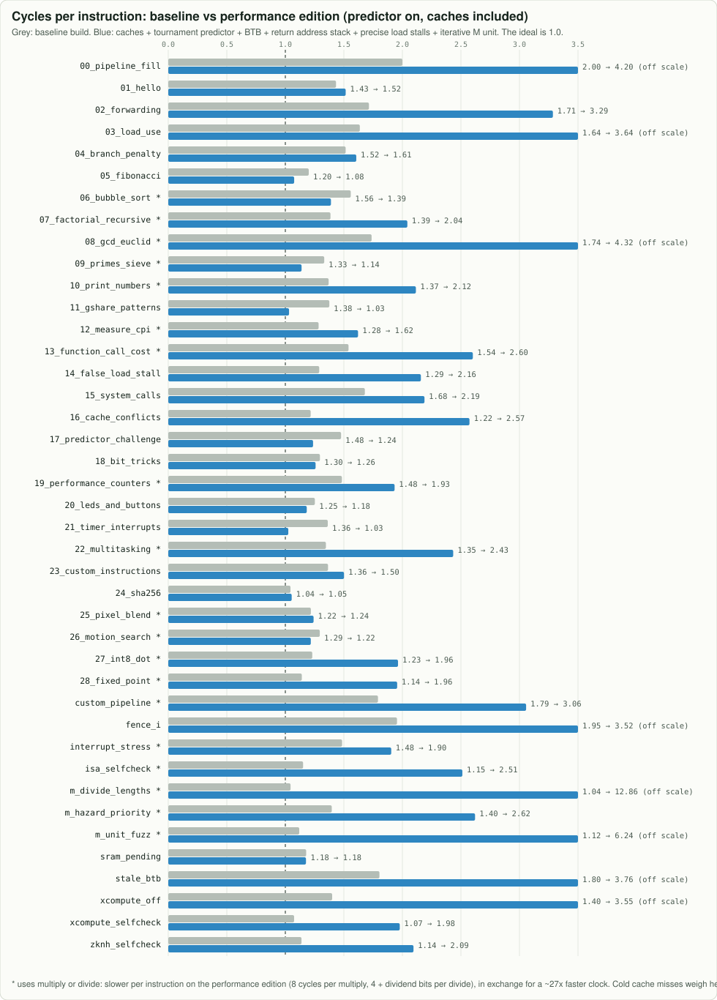
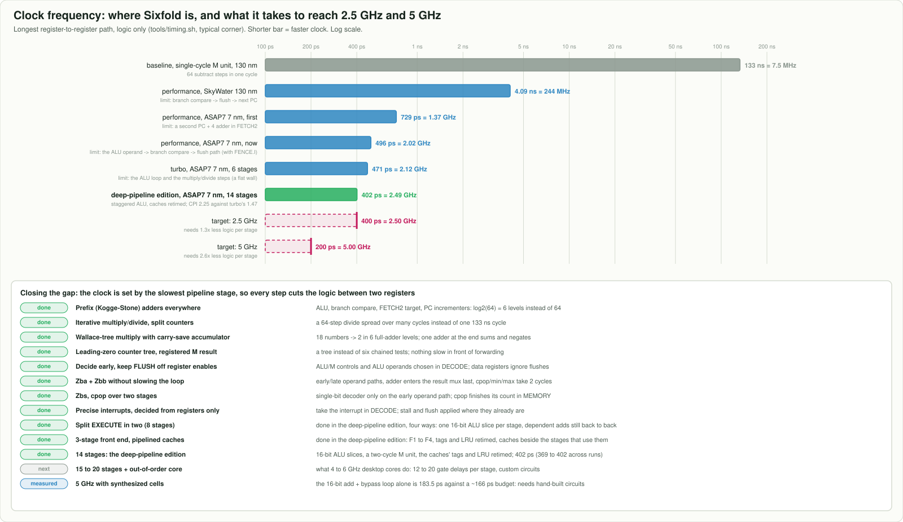

# Performance: a shorter critical path, fewer wasted cycles, a realistic memory

How the performance edition was built from the baseline pipeline, what each change bought, and what
it cost. Every number is produced by a script in this repository, and every behavioural change is
verified cycle by cycle against the RTL by `make test`, which builds **both** designs.

| build | how to get it | what it is |
|---|---|---|
| **performance** (default) | `make test`, `make run PROG=...` | 4 KiB 2-way set-associative instruction cache with next-line prefetch, 4 KiB 2-way write-through data cache (LRU replacement), tournament predictor (per-branch history table + gshare + chooser), 16-entry branch target buffer, 8-entry return address stack, precise load stalls, iterative multiply/divide, Kogge-Stone adders |
| **baseline** | `-DBASELINE`, `CONFIG=baseline` | the plain 6-stage pipeline: single-cycle 64 KiB memory, 4-bit gshare only, single-cycle multiply/divide |

Every feature is a parameter of [`src/Riscv64.sv`](../src/Riscv64.sv) / [`src/Riscv64_top.sv`](../src/Riscv64_top.sv)
(`CACHES_ENABLE`, `MISS_LATENCY`, `TOURNAMENT_PREDICTOR`, `BTB_ENABLE`, `RAS_ENABLE`,
`PRECISE_LOAD_STALL`, `ITERATIVE_MULTIPLY_DIVIDE`, `GSHARE_HISTORY_BITS`), with the same switches in
`CONFIGS` in [`model/core.js`](../model/core.js), so each one can be measured on its own.

## The result



| program | M ops | baseline: cycles | CPI | performance: cycles | CPI | time, baseline 130 nm (7.5 MHz) | time, performance 130 nm (244 MHz) | time, performance 7 nm (1.95 GHz) |
|---|:-:|---:|---:|---:|---:|---:|---:|---:|
| `00_pipeline_fill` |  | 10 | 2.00 | 21 | **4.20** | 1.3 µs | 0.09 µs | 0.01 µs |
| `01_hello` |  | 139 | 1.43 | 147 | **1.52** | 18.5 µs | 0.60 µs | 0.08 µs |
| `02_forwarding` |  | 12 | 1.71 | 23 | **3.29** | 1.6 µs | 0.09 µs | 0.01 µs |
| `03_load_use` |  | 18 | 1.64 | 40 | **3.64** | 2.4 µs | 0.16 µs | 0.02 µs |
| `04_branch_penalty` |  | 50 | 1.52 | 53 | **1.61** | 6.7 µs | 0.22 µs | 0.03 µs |
| `05_fibonacci` |  | 366 | 1.20 | 328 | **1.08** | 48.8 µs | 1.34 µs | 0.17 µs |
| `06_bubble_sort` | yes | 1,124 | 1.56 | 1,002 | **1.39** | 149.9 µs | 4.11 µs | 0.51 µs |
| `07_factorial_recursive` | yes | 327 | 1.39 | 482 | **2.04** | 43.6 µs | 1.98 µs | 0.25 µs |
| `08_gcd_euclid` | yes | 33 | 1.74 | 82 | **4.32** | 4.4 µs | 0.34 µs | 0.04 µs |
| `09_primes_sieve` | yes | 19,773 | 1.33 | 16,899 | **1.14** | 2636.4 µs | 69.26 µs | 8.67 µs |
| `10_print_numbers` | yes | 737 | 1.37 | 1,138 | **2.12** | 98.3 µs | 4.66 µs | 0.58 µs |
| `11_gshare_patterns` |  | 1,519 | 1.38 | 1,139 | **1.03** | 202.5 µs | 4.67 µs | 0.58 µs |
| `12_measure_cpi` | yes | 122 | 1.28 | 154 | **1.62** | 16.3 µs | 0.63 µs | 0.08 µs |
| `13_function_call_cost` | yes | 174 | 1.54 | 294 | **2.60** | 23.2 µs | 1.20 µs | 0.15 µs |
| `14_false_load_stall` |  | 49 | 1.29 | 82 | **2.16** | 6.5 µs | 0.34 µs | 0.04 µs |
| `15_system_calls` |  | 89 | 1.68 | 116 | **2.19** | 11.9 µs | 0.48 µs | 0.06 µs |
| `16_cache_conflicts` |  | 208 | 1.22 | 440 | **2.57** | 27.7 µs | 1.80 µs | 0.23 µs |
| `17_predictor_challenge` |  | 7,492 | 1.48 | 6,277 | **1.24** | 998.9 µs | 25.73 µs | 3.22 µs |
| `18_bit_tricks` |  | 732 | 1.30 | 711 | **1.26** | 97.6 µs | 2.91 µs | 0.36 µs |
| `19_performance_counters` | yes | 173 | 1.47 | 231 | **1.96** | 23.1 µs | 0.95 µs | 0.12 µs |
| `20_leds_and_buttons` |  | 1,266 | 1.25 | 1,196 | **1.18** | 168.8 µs | 4.90 µs | 0.61 µs |
| `21_timer_interrupts` |  | 13,236 | 1.36 | 10,056 | **1.03** | 1764.8 µs | 41.21 µs | 5.16 µs |
| `22_multitasking` | yes | 35,510 | 1.35 | 82,959 | **2.43** | 4734.7 µs | 340.00 µs | 42.56 µs |
| `interrupt_stress` | yes | 16,062 | 1.48 | 21,540 | **1.90** | 2141.6 µs | 88.28 µs | 11.05 µs |
| `isa_selfcheck` | yes | 14,346 | 1.15 | 31,292 | **2.51** | 1912.8 µs | 128.25 µs | 16.06 µs |

Geometric-mean speed-up of the performance edition over the baseline, both on 130 nm: **24.3x** (clock and cycles together). Cache misses are included: these programs are tiny, so their few cold misses weigh heavily.

## Part 1: cycles per instruction

`cycles = N + 5 + L + 3F + R + K + I + D + X + B` ([MATH.md](MATH.md)) says exactly where every cycle above
one per instruction comes from.

| change | term | how | cost |
|---|---|---|---|
| **Branch Target Buffer** | R | 16 entries remember "the instruction at this PC jumped to that PC"; FETCH1 redirects immediately | 960 flip-flops |
| **Return Address Stack** | F | calls push PC + 4 in FETCH2, returns pop and redirect (1 bubble instead of a 3-bubble flush); the pointer is checkpointed and restored on flushes | 8 x 64-bit entries |
| **Tournament predictor** | F | a per-branch history table (fast learner) next to gshare (pattern learner), and a chooser per branch that learns which to trust (Alpha 21264 style) | 2 x 128 two-bit counters |
| **Precise load stalls** | L | `ControlUnit` reports `USES_REGISTER1/2`, so only real dependences stall | a few gates |
| **Instruction cache + next-line prefetch** | I | after a miss on line X, line X + 1 is fetched in the background: sequential code misses half as often (self-check: 917 → 459 misses) | 4 KiB SRAM + tags |
| **Data cache** | D | write-through: stores never wait; only loads that miss wait for their line | 4 KiB SRAM + tags |
| **Data next-line prefetch** | D | after a load miss on line X, line X + 1 is fetched in the background (sieve: 32 → 16 data misses) | a second refill request path |
| **2 ways + LRU** (both caches) | I, D | two lines per set, so addresses 2 KiB apart no longer evict each other; `16_cache_conflicts.s` shows 2 arrays fitting and 3 thrashing | a second tag compare, 1 LRU bit per set |

Why add caches if they add cycles? The baseline assumes 64 KiB of memory that answers in one cycle.
That is fine in a simulator but not in silicon: a memory that large cannot be read in one short clock
cycle. Real CPUs keep small, fast caches next to the pipeline and pay a miss penalty now and then.
The penalty here is `MISS_LATENCY + 1 = 11` cycles; long-running code hides it (the sieve runs at CPI
1.15 with caches), while programs of a few dozen instructions are dominated by their cold misses.

## Part 2: frequency

```bash
make timing                              # both builds on SkyWater 130 nm
tools/timing.sh performance asap7        # the same RTL on ASAP7, a 7 nm-class library
```

sv2v converts the SystemVerilog, Yosys synthesizes it without area-oriented rewriting and without
resource sharing (`-noshare`, see the third round), and ABC restructures it for delay (sum-of-products balancing, `&if -g` and `&b` [47]), maps it onto the cell
library and reports the longest register-to-register path. **Logic only**: no wires, clock skew or
slow corner; after place and route expect 1.5x to 2.5x longer. The cache memories are left out (a
real chip uses SRAM macros for them). ABC has some run-to-run spread: near-equal paths can swap
places and move the result by about 5%.



### The first round (130 nm)

| step | limiting path | 130 nm |
|---|---|---:|
| baseline RTL, M unit excluded | `EXECUTE_PC + 4` incrementer on the flush path | 4.6 ns |
| baseline single-cycle multiply/divide unit alone | 64 subtract steps in a row | **133 ns** |
| Kogge-Stone prefix adders (ALU, branch compare, FETCH2 target), PC + 4 carried down the pipeline | | 4.1 ns (M excluded) |
| iterative multiply/divide unit | its setup, then its negation | 11.1 → 5.9 ns |
| prefix-OR negation, magnitudes a cycle earlier, return check against `rs1` | | 4.8 ns |
| tournament predictor, prefix incrementers for the PCs | FETCH2 target → next-PC mux | 5.0 ns |
| 64-bit counters split into halves with a registered carry | the multiply step (64 x 16 bits + accumulate) | 5.5 ns (180 MHz) |

### The second round (7 nm): 729 ps → 522 ps

Each row is one change, measured with `tools/timing.sh performance asap7`, and each was checked
cycle-exact against the model on all 76 regression runs before the next one.

| change | why it was slow | cost | 7 nm |
|---|---|---|---:|
| start of this round | `FETCH2_PC + 4` for the Return Address Stack | | 729 ps |
| **PC + 4 registered from FETCH1** instead of recomputed in FETCH2 | a second 64-bit incrementer after a register | 64 flip-flops | 709 ps |
| delay-oriented mapping in the flow (SOP balancing) | now shows the real limit clearly: the multiply step | | 747 ps |
| **Wallace-tree multiply step** ([`Carry_Save_Multiplier.sv`](../src/Carry_Save_Multiplier.sv)) [44] | `A * B[15:0] + acc` became 16 rows of ripple adders | none | 597 ps |
| **registered M result** (a SIGN cycle) | a 128-bit negation in front of the forwarding multiplexers | +1 cycle per M instruction | 608 ps |
| **carry-save accumulator**: the product stays two numbers until SIGN, where one adder sums **and** negates it (`-(x+y) = ~(x + y - 1)`) | an 80-bit carry-propagate adder in every step | none | 599 ps |
| **leading-zero counter tree** [46] + a separate ALIGN cycle for divides | "is the top half zero? shift" six times in a row | +1 cycle per divide | 555 ps |
| **ALU subtract decoded in DECODE** (a flip-flop, not logic) | op decode → 64 inverters → adder | 1 flip-flop | 560 ps |
| **EXECUTE operand registers no longer wait for FLUSH** | branch compare → flush → enable of ~1,000 flip-flops | none | 575 ps |
| **private 3-bit store-offset adder** | store lanes waited for the full ALU and its result multiplexer | a 3-bit adder | 546 ps |
| **multiply/divide signedness decoded in DECODE** | op decode in front of the operand negation | 3 flip-flops | 527 ps |
| **ALU operands chosen in DECODE** (`EXECUTE_ALU_INPUT_A/B` are registers) | a 2:1 multiplexer with a 64-bit fan-out select in front of the adder | 128 flip-flops | 541 ps |
| **front-end registers (FETCH2, DECODE) no longer wait for FLUSH** | the same flush-to-enable path in the front end | none | **522 ps** |

### The third round: 32 more instructions and six counters, same clock at 7 nm

Adding Zba and Zbb put a leading-zero counter, a population count, a rotator, byte shuffles and
min/max next to the adder, and a shift-and-zero-extend in front of it. Measured on the way:

| step | 7 nm |
|---|---:|
| end of the second round, re-measured with the final flow below | 538 ps |
| Zba/Zbb added naively (operand preparation after forwarding, everything in the result multiplexer) | 758 ps |
| found: Yosys's `share` pass had merged the ALU's shifters with another shifter into one "supercell" steered by logic that depends on the branch flush. A timing-driven flow never shares on a critical path, so the flow now runs `synth -noshare` (this also explains the odd flush-to-operand paths of the second round) | 629 ps |
| `cpop` gets a 2-cycle latency (`EXECUTE_LATE_RESULT`): a 64-bit popcount tree is deeper than the adder | 574 ps |
| the value forwarded from EXECUTE takes its own short path through operand preparation (early/late split), and the adder enters the ALU's result multiplexer last | 576 ps |
| `min`/`max` get the same 2-cycle latency: their compare comes out of the adder and then steers all 64 result bits | 547 ps |
| hardware performance counters (split 64-bit counters, off every critical path) | **523 ps** |

Cost in cycles: an instruction that uses a `cpop`, `min` or `max` result right away waits one cycle
(like a load). Every other new instruction is single-cycle. The 7 nm clock is where it was before the
new instructions (within ABC's run-to-run spread).

| build | SkyWater 130 nm | ASAP7 7 nm-class |
|---|---:|---:|
| baseline (single-cycle M unit excluded) | 4.41 ns (227 MHz) | 0.51 ns (1.98 GHz) |
| **performance** (everything included) | **4.28 ns (234 MHz)** | **0.52 ns (1.91 GHz)** |

At 130 nm the population count is now the longest path (its small adders chain up: about 13 full
adders deep), which costs 130 nm about 12% against the second round; at 7 nm it has slack.

The remaining paths are all within a few percent of each other (500 to 520 ps), and the main one is
the loop every simple pipeline has: **ALU → result multiplexer → forwarding multiplexer → the next
instruction's operand register**. One 64-bit add plus about four levels of multiplexing is roughly
500 ps in this library. At 130 nm the limit is the population count (see above).

### The fourth round: the rest of the B extension, and cpop split across two stages

Zbs adds single-bit set, clear, invert and extract. Where its 6-to-64 decoder goes decides the clock.
Measured at 7 nm, one change at a time:

| step | 7 nm | 130 nm |
|---|---:|---:|
| end of the third round | 523 ps | 4.28 ns (limit: `cpop`) |
| Zbs inside the ALU: the decoder in EXECUTE, four more inputs on the result multiplexer | 543 ps | |
| `cpop` split across two stages: nibble lookups and four 16-bit quarter counts in EXECUTE, the last addition in MEMORY (where it sits beside LoadControl's lane selection, which is slower) | | 4.14 ns |
| (experiment) the same without Zbs at all | 485 ps | |
| Zbs as operand preparation in DECODE (`bset` = OR, `bclr` = AND, `binv` = XOR with a prepared single bit), decoder on both the early and the late path | 571 ps (the decoder landed in the forwarding loop) | |
| **the decoder on the early path only**: a `bset`/`bclr`/`binv` whose bit number the previous instruction computes waits one cycle (`SINGLE_BIT_HAZARD`, counted as a load stall) | **536 ps** | **3.75 ns** |

The final 7 nm limit is no longer the ALU loop but the divider's SIGN step (the 64-bit remainder
negation, then the result select), which ABC's run-to-run spread moves by a few percent either way.
At 130 nm the split `cpop` gave back more than it had cost: **267 MHz**, the best so far.

| build | SkyWater 130 nm | ASAP7 7 nm-class |
|---|---:|---:|
| **performance** (everything included) | **3.75 ns (267 MHz)** | **0.536 ns (1.87 GHz)** |

Cost in cycles: none for any program in `programs/` (their `bset`s take bit numbers computed earlier);
the self-check, which computes every bit number right before using it, pays 20 cycles in 31,138.

### The fifth round: interrupts

Precise timer and external interrupts add a decision in DECODE (take the interrupt instead of the
instruction?), a pseudo-instruction flag through EXECUTE, and two registered interrupt lines in the CSR
file. The decision uses only registered signals: the stall and flush conditions are applied by the
pipeline-register code that already has them, so no branch outcome reaches the new logic. A first version
that tested `FLUSH` inside the decision put the branch comparator in front of one more flip-flop input.
Measured with the same flow:

| build | SkyWater 130 nm | ASAP7 7 nm-class |
|---|---:|---:|
| **performance** with interrupts | **4.09 ns (244 MHz)** | **0.513 ns (1.95 GHz)** |

Both limits now start at the branch comparator's operand (`EXECUTE_REGISTER1_DATA`): compare, flush, then
the next-PC multiplexer. The numbers move by a few percent from run to run of ABC's delay-driven mapping
(this round saw 3.75 to 4.10 ns at 130 nm and 501 to 536 ps at 7 nm for very similar netlists), so a
change smaller than about 5% is below what this logic-only flow can resolve.

Re-measured after the Basys 3 round (which changed no logic of the core): `make timing` gives 3.66 ns
(273 MHz) for the performance build and 3.35 ns for the baseline without its M unit. That is the same
spread again, so this page, the README and the site keep the conservative 244 MHz.

Re-measured after adding custom instructions ([CUSTOM_INSTRUCTIONS.md](CUSTOM_INSTRUCTIONS.md)), with the
four examples built in: 4.05 ns (247 MHz) at 130 nm and 521 ps (1.92 GHz) at 7 nm. At both nodes the
longest path now starts in the custom unit (the 64-bit population count of `hamming`, which runs in the
MEMORY stage), but both numbers are inside the run-to-run spread above; without `hamming` the 130 nm
figure is 3.90 ns with the core's own path the longest. The published 244 MHz holds; at 7 nm the default
build is about 1.92 GHz rather than 1.95 GHz.

Re-measured after adding the nine packed instructions ([XCOMPUTE.md](XCOMPUTE.md#timing-and-area)): on the
performance build, 4,415 ps without them and 3,853 ps with them at 130 nm, 537 ps and 526 ps at 7 nm; the
turbo build 4,703 ps and 3,789 ps at 130 nm. With them, the slowest path starts in the custom unit (the
`pdot.h` sum in MEMORY) at both nodes. The differences are inside this flow's spread, so the published
clocks hold; the logic area grows by about a quarter (327,007 to 414,031 µm² at 130 nm). The packed
kernels run 9.3x (baseline) to 13.0x (performance, deep) faster, geometric mean over six kernels.

The caches are not in this measurement (they would be SRAM macros on a chip, timed separately). On an
FPGA they are real logic, and there they set the clock: see [FPGA.md](FPGA.md#7-results).

## The turbo edition: cycles back from the multiply/divide unit and the instruction cache

A third build, `CONFIG=turbo` (`-DTURBO` in the testbench), is the performance edition with the
`FAST_*` parameters of [`src/Riscv64.sv`](../src/Riscv64.sv) and [`src/Riscv64_top.sv`](../src/Riscv64_top.sv)
switched on. The performance edition is left exactly as it was: the parameters default to 0, so the cached
FPGA system and anything else that instantiates `Riscv64` or `InstructionCache` with its defaults sees no
change. `make test` builds and compares all three; `make turbo-report` writes the table below.

**Where the cycles were.** Summed over every program, the cycle equation of [MATH.md](MATH.md) says the
performance edition spent 211,022 of its 434,210 cycles in K, the multiply/divide unit holding EXECUTE.
Even before the new multiply/divide stress test was added, K was 57% of all cycles above one per
instruction. The next largest removable term was I, cold instruction-cache misses in long straight-line code.

### `FAST_MULTIPLY_DIVIDE`: a separate unit, `FastMultiplyDivideUnit`

It lives in [`Iterative_Multiply_Divide_Unit.sv`](../src/Iterative_Multiply_Divide_Unit.sv), next to the
performance edition's unit (a first version that put both behind one `FAST` parameter of a shared module made
the synthesized performance build slower, 4729 ps at 130 nm, even with the parameter off).

| change | cycles saved | why the clock does not pay for it |
|---|---|---|
| **no PREPARE cycle** when no operand is negative: IDLE loads the step registers from the operands directly | 1 per multiply and per divide (a negative operand of `mulh`, `mulhsu`, `div` or `rem` still takes it) | the 64-bit negation feeds only the registers that PREPARE copies from, never the step registers |
| **64 x 32-bit multiply steps**: 2 steps instead of 4 | 2 per multiply | a deeper Wallace tree (34 numbers to 2 in 8 full-adder levels instead of 18 in 6); measured alone, 413 ps instead of 311 ps at 7 nm |
| **radix-4 division**: two quotient bits per step, trying D, 2D and 3D side by side (3D computed once in ALIGN), the remainder picked by a one-hot select | half the divide steps | one subtraction plus a 4-way select per step, not two subtractions in a row |
| **leading zeros counted in IDLE**, of A or of ~A for a negative A (one fewer is subtracted in ALIGN) | with the above, ALIGN follows IDLE | the count runs beside the negation, not after it; at worst one extra bit for a negative dividend |
| **only as many divide steps as the quotient has bits**: leading zeros of B (or ~B) are counted in IDLE too; ALIGN runs ceil((a - d + 1) / 2) steps for an a-bit dividend and a d-bit divisor, and starts the remainder at the dividend's top bits that no step needs | 64-bit / 64-bit: all but one step; `x % 7` with x below 500: 3 steps instead of 5 | the shift amount is the inverted bits of a 7-bit difference, no adder in front of the shifter; zeros and ones are counted side by side so the sign does not wait in front of 64 XOR gates (a first version that did not was 4460 ps at 130 nm) |
| **the result leaves in SIGN** as a late result (like `cpop`): no DONE cycle, no result register | 1 per M instruction; an instruction that needs the result right away waits 1 (counted in L) | the result goes only into the MEMORY pipeline register, never in front of forwarding |
| **no negation in SIGN**: the quotient is built "on the fly" as Q and Q - 1, so -Q = ~(Q - 1); a negative remainder takes one extra NEGATE cycle into a register of its own | (makes the above possible) | a 64-bit carry chain never sits between SIGN and the MEMORY register |

A multiply now takes 4 cycles in EXECUTE (was 8), a divide 3 + T with T = ceil((a - d + 1) / 2), at least 1 (was 5 + a), for an a-bit dividend and a d-bit divisor,
plus 1 for PREPARE or NEGATE where they apply. `model/core.js` (`multiplyDivideSteps` with `fast`) uses
exactly these counts, and `make math` checks the equation on every build.

### `FAST_INSTRUCTION_PREFETCH`: the instruction cache keeps the stream one line ahead

The performance edition's instruction cache prefetches line X + 1 only after a demand miss on line X, so
straight-line code misses every other line. With `STREAM_PREFETCH` the refill engine, whenever it is idle,
also fetches the line after the one FETCH1 is in, if it is missing. The next-line address is registered from
the fetch address, so the extra tag check reads only registers. One refill engine and an 11-cycle line
fill still cannot keep up with 8 instructions per line at one per cycle, so long straight-line code still
waits about 3 cycles per line instead of about 11 every two lines. The self-checks, which are 12,000 and
2,000 instructions of straight-line code, show it best (`isa_selfcheck` 2.51 to 1.75, `zknh_selfcheck` 2.09
to 1.54); loops are unaffected.

### A bug found on the way

A DECODE hazard right behind an M instruction that was still iterating (a custom instruction's result in
MEMORY, or a `bset` whose bit number the `mul` computes) let the load stall win over the multiply/divide
stall: EXECUTE got a bubble and the unfinished M instruction went on to MEMORY with the previous M result.
The model computed the right value, the RTL wrote the stale one (`mul` then `bset` gave 3 instead of 4, for
example). No existing program hit it. The multiply/divide stall now wins in every build, and
[`tests/m_hazard_priority.s`](../tests/m_hazard_priority.s) fails without the fix and passes with it.
[`tests/m_unit_fuzz.s`](../tests/m_unit_fuzz.s) runs 400 random operand pairs (every size, both signs, 0, -1
and the most negative number) through all 13 M instructions and compares every register of the RTL with the
model's BigInt arithmetic, on all builds.

### The clock: four changes that move work off the longest paths

The first two features bought cycles. These four buy clock: each moves logic off a path that limited the
whole core, measured with `tools/path_report.py` (the slowest path into every group of registers, from the
netlist `tools/timing.sh` maps). None changes what a program computes, and the model counts their cost
cycle for cycle (`make test` compares every cycle of the RTL with it).

| parameter | what moves | what it costs |
|---|---|---|
| `LATE_BRANCH_RESOLVE` | a branch or JALR stores its outcome (taken, target, the history and return-stack positions to restore) in the MEMORY pipeline register and flushes one cycle later. The comparator now feeds only flip-flops: no compare, then select, then next PC, then every front-end enable, in one cycle. Predictor and BTB training move to MEMORY too | a wrong guess costs 4 bubbles instead of 3: the instruction behind the branch, already in EXECUTE, is removed too. The new term B of the cycle equation counts them, and `hpmcounter10` counts them in hardware ([MATH.md](MATH.md#2-exact-cycle-count)) |
| `FAST_ALU` | DECODE hands EXECUTE one select line per ALU result (`alu_select` in `src/Riscv64.sv`), so the result multiplexer is an AND-OR tree that never waits for an operation-code comparison. `clz` and `ctz` join `cpop` as late results, `min` and `max` finish in MEMORY (EXECUTE sends only the comparison), and a Zba `shNadd` / `.uw` whose operand EXECUTE is computing waits a cycle instead of shifting the forwarded value inside the loop | 1 cycle when the very next instruction uses one of those results (counted in L) |
| `FAST_FETCH_TARGET` | FETCH2 adds the branch immediate and the JAL immediate in two adders at once and picks a sum, instead of picking an immediate in front of one adder | a second 64-bit adder; no cycles |
| `FAST_STALL` | the hazard checks of DECODE come from flip-flops: the FETCH2 instruction is decoded one cycle ahead, and its register numbers are compared with the destination of the instruction that will be in EXECUTE then (four compares side by side, one picked by the stall signals). `LOAD_STALL`, which holds hundreds of front-end flip-flops, is now a few gates after flip-flops | a second copy of the control decoder; no cycles |

Measured with the same flow before and after (logic only; this flow's run-to-run spread is about 5 to 10%):

| | ASAP7 7 nm-class | SkyWater 130 nm |
|---|---:|---:|
| turbo build before these four | 533 ps | 3882 ps |
| turbo build with them | 485 ps (2.06 GHz) | 3629 ps (276 MHz) |
| performance build, measured again on the same day | 533 ps | 3986 ps |

The cycles they cost: summed over all 32 programs, turbo CPI went from 1.914 to 1.930 (+0.8%), 1,796 B bubbles
and about 60 more load stalls. Run time is instructions x CPI x clock period, so at 7 nm that is
0.91 x 1.008 = 0.92 of the time before: 8% faster. Its clock period is now 9% shorter than the performance
build's in both libraries.
After them the slowest paths were a wall of about 480 to 520 ps at 7 nm: the custom unit into the register
file's write data, a load's byte selection forwarded into the next ALU operand, and the steps of the
multiply/divide unit.

#### Two more, and two experiments that did not pay

| change | what moves | what it costs |
|---|---|---|
| popcount in two halves (the custom-instruction generator, every build) | `CustomPrepare` counts the ones of each `popcount` argument in four 16-bit quarters in EXECUTE, on the registered operands; MEMORY only adds the four counts (the first 3 popcounts of an instruction set; more stay whole) | 20 flip-flops per popcount; no cycles |
| `FAST_LOAD_ALIGN` (turbo) | `LoadLanes` decides in EXECUTE, from funct3 and the 3-bit address offset, which source byte lands in each result byte and which bytes are sign or zero fill; MEMORY does one 8-way AND-OR per byte (`FastLoadControl` in `src/Load_Control_Unit.sv`) | 80 flip-flops; no cycles |

The custom unit alone (inputs to output, ASAP7) went from 484 ps to 357 ps; `hamming` was 444 ps of it. In
the whole turbo core (`python3 tools/path_report.py turbo asap7`), the register file's write data went from
521 to 447 ps and a load's byte selection no longer leads any group. The whole core measured 471 ps at 7 nm
(2.12 GHz, logic only) and 3968 ps at 130 nm, where a divide step now leads: both moves are inside this flow's
run-to-run spread, because the rest of the wall is still there:

| experiment (ASAP7, turbo with both changes above) | whole core | CPI over all programs |
|---|---:|---:|
| as built | 471 ps | 1.930 |
| no forwarding from EXECUTE: every result reaches the next instruction from MEMORY, so the ALU loop is cut | 473 ps | 2.211 (+14.6%) |
| the multiplier in 4 steps of 64 x 16 bits instead of 2 of 64 x 32 (`MULTIPLY_STEP_BITS` 16) | 469 ps | (2 more cycles per multiply) |
| both together | 425 ps | above 2.211 |

So the wall is two walls of the same height: the ALU loop (operand, adder, forwarding, operand) and the
multiply/divide steps. Cutting either alone buys nothing; cutting both buys 10% of clock for at least 15% more
cycles, a net loss. Neither experiment is in the build. The next real step is a different pipeline, not
another single path (see "What to try next").

### The result

| program | performance: cycles | CPI | turbo: cycles | CPI | change |
|---|---:|---:|---:|---:|---:|
| `00_pipeline_fill` | 21 | 4.20 | 21 | **4.20** | 0.0% |
| `01_hello` | 147 | 1.52 | 149 | **1.54** | 1.4% |
| `02_forwarding` | 23 | 3.29 | 23 | **3.29** | 0.0% |
| `03_load_use` | 40 | 3.64 | 40 | **3.64** | 0.0% |
| `04_branch_penalty` | 53 | 1.61 | 55 | **1.67** | 3.8% |
| `05_fibonacci` | 328 | 1.08 | 330 | **1.08** | 0.6% |
| `06_bubble_sort` | 1,002 | 1.39 | 1,004 | **1.39** | 0.2% |
| `07_factorial_recursive` | 482 | 2.04 | 399 | **1.69** | -17.2% |
| `08_gcd_euclid` | 82 | 4.32 | 55 | **2.89** | -32.9% |
| `09_primes_sieve` | 16,899 | 1.14 | 17,012 | **1.15** | 0.7% |
| `10_print_numbers` | 1,138 | 2.12 | 888 | **1.65** | -22.0% |
| `11_gshare_patterns` | 1,139 | 1.03 | 1,143 | **1.04** | 0.4% |
| `12_measure_cpi` | 154 | 1.62 | 129 | **1.36** | -16.2% |
| `13_function_call_cost` | 294 | 2.60 | 225 | **1.99** | -23.5% |
| `14_false_load_stall` | 82 | 2.16 | 72 | **1.89** | -12.2% |
| `15_system_calls` | 116 | 2.19 | 117 | **2.21** | 0.9% |
| `16_cache_conflicts` | 440 | 2.57 | 443 | **2.59** | 0.7% |
| `17_predictor_challenge` | 6,277 | 1.24 | 6,510 | **1.28** | 3.7% |
| `18_bit_tricks` | 711 | 1.26 | 679 | **1.20** | -4.5% |
| `19_performance_counters` | 232 | 1.93 | 219 | **1.82** | -5.6% |
| `20_leds_and_buttons` | 1,196 | 1.18 | 1,197 | **1.18** | 0.1% |
| `21_timer_interrupts` | 10,056 | 1.03 | 10,058 | **1.02** | 0.0% |
| `22_multitasking` | 82,959 | 2.43 | 57,144 | **1.94** | -31.1% |
| `23_custom_instructions` | 638 | 1.50 | 604 | **1.42** | -5.3% |
| `24_sha256` | 7,648 | 1.05 | 7,562 | **1.04** | -1.1% |
| `tests/custom_pipeline` | 93,863 | 3.06 | 54,301 | **2.14** | -42.1% |
| `tests/interrupt_stress` | 21,540 | 1.90 | 18,235 | **1.64** | -15.3% |
| `tests/isa_selfcheck` | 31,292 | 2.51 | 20,903 | **1.68** | -33.2% |
| `tests/m_divide_lengths` | 79,312 | 12.86 | 28,614 | **4.64** | -63.9% |
| `tests/m_hazard_priority` | 152 | 2.62 | 113 | **1.95** | -25.7% |
| `tests/m_unit_fuzz` | 150,699 | 6.24 | 64,852 | **2.68** | -57.0% |
| `tests/zknh_selfcheck` | 4,508 | 2.09 | 3,316 | **1.54** | -26.4% |

Geometric-mean cycle reduction, turbo over performance: **15.6%** over 32 programs.

Every cycle above one per instruction, summed over all 32 programs (`cycles = N + 5 + L + 3F + R + K + I + D + X + B` per program):

| build | N | cycles | CPI | L | 3F | R | K | I | D | X | B |
|---|---:|---:|---:|---:|---:|---:|---:|---:|---:|---:|---:|
| performance | 163,734 | 513,523 | 3.136 | 14,098 | 24,672 | 3,725 | 284,110 | 14,367 | 5,570 | 3,087 | 0 |
| turbo | 153,545 | 296,412 | 1.930 | 22,732 | 17,844 | 3,926 | 83,014 | 5,866 | 5,572 | 1,957 | 1,796 |

(N differs between the builds because the interrupt programs wait for a timer: a faster core runs its idle loop more often. B is the extra bubble of a branch resolved one stage later, LATE_BRANCH_RESOLVE.)

**Clock.** The same flow as above (`tools/timing.sh turbo` and `tools/timing.sh performance`). Before the four
clock changes above:

| build | SkyWater 130 nm | ASAP7 7 nm-class |
|---|---:|---:|
| performance | 3832 ps (261 MHz) | 483 ps (2.07 GHz) |
| turbo | 3882 ps (258 MHz) | 533 ps (1.88 GHz) |

With them, turbo is 3629 ps and 485 ps (the table in the section above). These first numbers are after the custom-instruction generator moved to prefix adders
([CUSTOM_INSTRUCTIONS.md](CUSTOM_INSTRUCTIONS.md#what-fits-in-a-cycle); before it, 4055 ps and 511 ps for
performance, 4193 ps and 522 ps for turbo). The two builds differ by 1% at 130 nm and 10% at 7 nm, and
neither longest path is in the turbo build's own logic, which points to this flow's run-to-run spread: the netlists differ, so ABC maps them
differently. The longest paths start in EXECUTE's operands and the ALU (7 nm) and in the custom unit's
operands (130 nm, both builds). Removing the turbo divide unit's remainder negation, or its operand negation,
from the 130 nm netlist moved the result by under 2% and moved the longest path to the custom unit, so the
divide unit does not set the clock.
Two lessons from getting there, each measured: Yosys and ABC map the same logic differently once the rest of
the netlist changes (a 66-bit negation came out as a 17-gate chain of OR gates at 130 nm, 4400 ps, until it was
written as a prefix adder), so a path measured alone with the same flow is the better guide for one block:
the 64 x 32 multiply step alone is 413 ps at 7 nm and 3145 ps at 130 nm, a 66-bit prefix adder 257 ps and 1397 ps.

**What is left between these programs and CPI 1.0.** The cycle-equation table is the honest scoreboard. A
single-issue pipeline can never go below CPI 1.0. What remains in the turbo build is, in order: K (mostly the
multiply/divide stress test), L (load-use waits, which a 6-stage pipeline with forwarding into DECODE cannot
avoid, plus late results), 3F (flushes: two thirds are traps and interrupts in the interrupt stress tests),
I (first misses) and D. The long-running real programs are already close: `11_gshare_patterns` 1.03,
`21_timer_interrupts` 1.02, `24_sha256` 1.05, `05_fibonacci` 1.08, `09_primes_sieve` 1.14. Going below 1.0
needs more than one instruction per cycle (dual issue).

## 2.5 GHz and 5 GHz

2.5 GHz is a 400 ps cycle and 5 GHz is 200 ps. The logic between two registers has to shrink by 1.3x
and 2.6x from here, and on a real chip wires and clock skew take part of the cycle too. The design
techniques that get there are known; each one costs cycles (CPI) or area:

* **Split EXECUTE in two** (an 8-stage pipeline): add in one stage, select and forward in the next.
  A dependent instruction then waits one cycle (like a load today), and a mispredicted branch costs
  4 bubbles instead of 3. This is the step that would take Sixfold under 400 ps.
* **A deeper front end**: BTB lookup, direction prediction and instruction-cache access in separate
  stages, as in every current core, with a small "next-line predictor" to keep fetching every cycle.
* **Pipelined caches**: a 4 to 5 cycle load-to-use latency on a 4 to 5 GHz desktop core.
* **15 to 20 stages and out-of-order execution**: at 5 GHz a stage holds only about 12 to 20 simple
  gate delays [48], so everything is pipelined, and out-of-order execution hides the extra latency.
* **Custom circuits and the process**: hand-placed datapaths, dynamic logic and a leading-edge node.
  Commercial 2 to 3 nm-class libraries are under non-disclosure agreements, so this repository
  measures on ASAP7, an open 7 nm-class predictive kit.

### The floor, measured: the ALU-bypass loop

However many stages a single-issue pipeline has, one loop has to close in one cycle if a dependent
instruction is to start the very next cycle: operand register, adder, bypass multiplexer, operand register.
`make clock-floor` synthesizes exactly that loop alone ([`tools/clock_floor/alu_bypass_loop.sv`](../tools/clock_floor/alu_bypass_loop.sv),
the same flow as the core) and reads the flip-flop's own share of the cycle from the ASAP7 flip-flop library:

| loop (ASAP7 7 nm-class, logic only) | logic | + flip-flop (53.5 ps clock-to-output + 10.2 ps setup) | clock at 7 nm | projected at 5 nm (÷ 1.15) |
|---|---:|---:|---:|---:|
| Sixfold today, the whole core (performance build) | 483 ps | 547 ps | 1.83 GHz | 2.10 GHz |
| Sixfold today, the whole core (turbo build, with the clock changes above) | 471 ps | 535 ps | 1.87 GHz | 2.15 GHz |
| the deep-pipeline edition, the whole core with its cache logic ([below](#the-deep-pipeline-edition-14-stages-measured)) | 402 ps | 466 ps | 2.15 GHz | 2.47 GHz |
| 64-bit add + bypass | 293.7 ps | 357 ps | 2.80 GHz | 3.22 GHz |
| 32-bit staggered add + bypass | 236.9 ps | 301 ps | 3.33 GHz | 3.83 GHz |
| 16-bit staggered add + bypass | 183.5 ps | 247 ps | 4.05 GHz | 4.65 GHz |

The 7 nm columns are measured; the 5 nm column is a projection, not a measurement: it divides by 1.15,
TSMC's published speed gain of its N5 process over N7 at the same power, because no open 5 nm library
exists. Wire delay and clock skew are not included in any row, and on a real chip they take 10 to 20% of
the cycle. What the table says:

* With a full 64-bit adder in one stage, no amount of pipelining elsewhere takes this flow past about
  3.2 GHz at 5 nm. Getting the rest of the core down to that loop is the first goal: 1.5x from today.
* A **staggered adder** (the low 16 or 32 bits in one cycle, the rest in the next, with the carry passed
  along; Intel's Pentium 4 ran its integer adders this way) lets a dependent add start every cycle anyway,
  and moves the floor to about 4.65 GHz at 5 nm.
* **5 GHz at 5 nm** is a 200 ps cycle, 230 ps at 7 nm, so at most about 166 ps of logic per stage. Even
  the 16-bit loop (183.5 ps) does not fit. From synthesized standard cells it needs a dependent ALU
  instruction to wait a cycle (CPI goes up on every chain of dependent instructions), or hand-built circuits.

## The deep-pipeline edition: 14 stages, measured

The step this section's list starts with, taken to its end: a separate build with 14 stages
(`F1 F2 F3 F4 D1 D2 X1 X2 X3 X4 M1 M2 M3 W`), a staggered ALU (16 bits per stage), only one stage that
stalls, a multiply/divide unit whose every state takes two cycles, and the cache logic retimed so it fits
the shorter cycle. It lives in its own files ([`src/deep/`](../src/deep), [`model/deep.js`](../model/deep.js)),
matches its model on every cycle, and is described in full in [DEEP_PIPELINE.md](DEEP_PIPELINE.md).

| | turbo | deep |
|---|---:|---:|
| logic, ASAP7 7 nm-class (measured; the deep edition's spread between equivalent runs is 369 to 402 ps) | 471 ps | 402 ps |
| clock at 7 nm / projected at 5 nm | 1.87 / 2.15 GHz | 2.15 / 2.47 GHz |
| CPI, example programs / tests (measured, `make deep-check`) | 1.472 / 2.337 | 2.249 / 4.396 |
| time per instruction, example programs, 7 nm | 787 ps | 1048 ps |

The clock is 15% faster, each instruction about 33% slower: on in-order, single-issue hardware the extra
stages cost more cycles than they win. 5 GHz stays out of reach for the reasons measured above (the 16-bit
loop alone is 183.5 ps against a budget of about 166 ps), and the deep edition's own wall is flat between
about 375 and 400 ps.

## Why not 2 nm, or 0.42 nm?

A process node is a property of the **factory**, not of the Verilog. The RTL describes logic; a
foundry's library of transistors decides how fast that logic switches. The same RTL here gives
4.28 ns on 130 nm and 0.52 ns on a 7 nm-class library, 8x faster, without changing a line.

* **2 nm** processes exist commercially (for example at TSMC, Samsung and Intel), but their design
  kits are under non-disclosure agreements; no open library below 7 nm exists to measure with.
  "2 nm" is also a marketing name: the actual gate pitch in such processes is tens of nanometres.
* **0.42 nm** is about the distance between neighbouring silicon atoms (0.235 nm bond length, 0.543 nm
  lattice constant). No transistor can be built at that scale; it is not a process node.

What this repository *can* show is the design side, which carries over to any node: measure the
critical path, make it shallower (prefix adders, Wallace trees, leading-zero trees), take decisions
a stage earlier (pre-decoding), keep slow control signals away from large register enables, spread
long work over several cycles (the iterative M unit), and win the cycles back with prediction and
caching.

## What to try next

* **The next wall (turbo, about 470 to 500 ps at 7 nm):** the ALU loop and the multiply/divide steps, which
  have to be cut together (measured above). A deeper pipeline does both: a staggered ALU (16 bits per stage,
  the floor table below), a multiply/divide unit with more, shorter steps, and the other paths of that height
  (the branch outcome into the redirect, the BTB lookup into the instruction-cache address) each in a stage
  of its own.
* **Split EXECUTE** into two stages and measure the clock gain against the extra bubbles.
* **Time the cache hit path**: address → tag compare → `DATA_CACHE_STALL` → every pipeline enable.
  With the tag SRAM included this is likely the next critical path.
* **Booth recoding** for the multiply step (8 partial products instead of 16). Radix-4 division is done (the turbo edition).
* **Real sign-off**: run OpenROAD on the sv2v output for placed-and-routed numbers.
