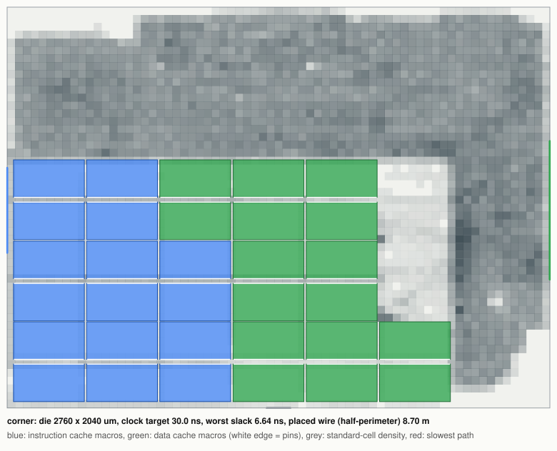
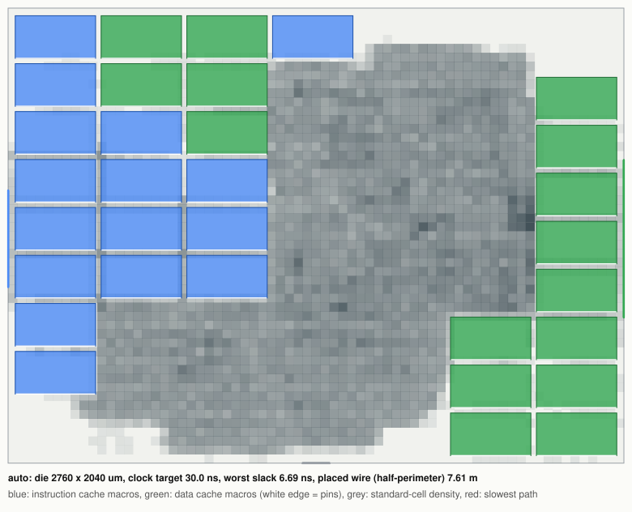

# Silicon: what this CPU looks like as a real chip

Everything on this page is real data: the final layout and reports of a 32-bit prototype of this pipeline
(SkyWater sky130), real sky130 standard-cell drawings, and open-source synthesis of
this repository's 64-bit RTL onto the sky130 high-density library.

## The whole die


A 3 mm x 3 mm die, but the logic covers only a few percent of it (cell density 2.8%): the rest is
filler and decoupling capacitors. The ten grey blocks at the lower left are SRAM macros from the
open-source sram22 generator: four data arrays and one tag array for each cache.

## The core


The placer groups cells that talk to each other. The register file (purple) is the largest block;
the pipeline logic (red) sits between it and the ALU (orange); the gshare predictor (teal) sits near
the fetch logic; the caches (blue and green) spread toward their SRAMs.

## The wiring


Five metal layers, alternating direction: met1 purple (inside cells), met2 blue (vertical), met3
green (horizontal), met4 orange (vertical, also over the SRAMs), met5 red (power and long wires).


These pictures are drawn by `tools/render_def.py` from the placed-and-routed DEF file: every
rectangle is one standard cell at its real position.

## Where the caches go: a planned floorplan for the 64-bit core

In the prototype above the ten SRAM macros sit together in the lower-left corner and the logic that uses them
sits near the middle of the die. Measured from its DEF file (`tools/floorplan.py`, Manhattan distance, because
wires run horizontally and vertically), the centre of the core's cells is about **2 mm** from each cache's tag
array:

| prototype (placed and routed), distance | instruction cache | data cache |
|---|---:|---:|
| core cells' centre to the tag array | 2,151 um | 1,996 um |
| cache controller's cells to its farthest SRAM | 768 um | 926 um |

The tag array is the one that matters most: every cycle, the address goes to the tags, the tags come back to
be compared, and the hit decides whether the pipeline stalls. A wire that long is slow even with a strong
driver. One `sky130_fd_sc_hd__buf_8` driving 2,151 um of metal 3 (its delay from the cell library at that
wire's capacitance, plus the wire's own resistance and capacitance from OpenROAD's sky130 values) takes
**655 ps** one way, before any logic. At the prototype's 26 ns clock that did not matter; at a few hundred
picoseconds it would be most of the cycle.


`make floorplan` draws a plan for this repository's 64-bit turbo core on the same process, with the caches
beside the stages that use them:

* **Measured:** every block's cell area (`tools/floorplan_areas.sh` synthesizes each one onto sky130 cells:
  register file 109,476 um2, multiply/divide unit 133,458, ALU 37,426, branch target buffer 37,531, and so
  on; the whole core 522,155), and the SRAM macros, which are the prototype's own `sram22` macros with their
  real sizes (150.4 x 225.26 um for 256 x 32 bits, 150.4 x 85.26 um for 64 x 32). Each cache's arrays come
  out at 32,768 data bits (4 macros) and 2,688 tag bits (one 64-entry macro per way, 2).
* **Assumed:** 65% of each logic region filled with cells (the rest is routing room), a 10 um keep-out around
  each macro, and the core's remaining logic (pipeline registers, forwarding, hazard and branch control,
  85,563 um2) spread over the stage columns in equal parts.
* **Arranged:** the stages left to right in pipeline order, the instruction cache's macros in a column on the
  FETCH side and the data cache's on the MEMORY side. The tag macros sit in the middle of each column, level
  with the block that sends them an address (the fetch logic and the ALU), with the data macros above and
  below. The multiply/divide unit, the largest block and not part of the one-cycle ALU loop, gets a column of
  its own, away from the data cache.

| planned (not placed), distance | instruction cache | data cache |
|---|---:|---:|
| address source (fetch logic, ALU) to the tag arrays | 364 um | 377 um |
| cache controller to its farthest SRAM | 650 um | 672 um |
| buf_8 + wire delay, address source to tags (prototype: 655 / 611 ps) | **184 ps** | **187 ps** |

The plan is 1,065 x 1,192 um of core area. It is a plan, not a layout: no placer or router has run on it
(that is the next step, with OpenROAD; see "Tools and flows" below), the distances are between block
centres, and the wire delays use one buffer and no repeaters. What it does show, with measured inputs, is the
principle: put each cache's tags next to the logic that addresses them, keep the large off-loop blocks out of
the way, and the address-to-tag distance shrinks 5 to 6 times and its delay about 3.5 times. Two consequences for a real chip:

* The cache RTL writes a whole 256-bit line in one cycle; a 32-bit-wide SRAM macro takes eight writes. Either
  the refill streams the line in over eight cycles, or, as in the next section, each way's line is spread over
  eight macros side by side, written in one cycle.
* On the 7 nm-class library the same core's logic is about 94 times smaller (4,022 um2 against 378,259 um2
  from `tools/timing.sh turbo`, both measured), so every distance shrinks by about the square root, 9.7 times.
  Wires get slower per micrometre at small nodes, so the arrangement matters more there, not less.

## Placing the cache SRAMs for real (OpenROAD)

The planned floorplan above is arithmetic. This section is the real flow that tests it: the turbo core with both
caches, synthesized, placed, given a clock tree and routed by OpenROAD on sky130, three times, with the cache
arrays in real SRAM macros put in three different places. Everything else is the same in all three runs: the
netlist, the die, the pins, the power grid, the clock target and every tool setting.

### The caches in SRAM macros

The caches normally keep their lines in flip-flops, read in the same cycle the address arrives. A real chip
keeps them in SRAM (static random-access memory) macros from a memory compiler, which are denser but answer
one clock edge after they are read. With `SRAM_CACHES = 1` (`Riscv64`, `riscv64_top`; default 0, so every other
build is unchanged) the caches keep their data in 32 `sram22_64x32m4w8` macros, each 64 words of 32 bits, from
the open-source sram22 generator (BSD-3-Clause, in [`asic/macros/`](../asic/macros)):

* **Instruction cache:** 16 macros, one per way and per word of the 8-word line, addressed by the set.
* **Data cache:** 16 macros, one per way and per half of each of the line's 4 doublewords. A store writes its
  bytes through the macro's byte mask.
* **Tags and valid bits stay in flip-flops,** so the hit and its way are known in the same cycle, as before.
* **No extra cycle.** The core already loads the cache's answer into a register (`FETCH2_INSTRUCTION`,
  `MEMORY_DATA_CACHE_DATA`). The cache reads the hit way's macro at exactly that clock edge (its `CAPTURE`
  input), so what the macro shows afterwards (`*_LATE`) is what that register would hold, and the core uses it
  in the register's place. The cycle equation does not change.
* **A refill writes all eight macros of the victim way at once.** If the core reads one of them in that same
  cycle, that word waits in a one-word `PENDING` register (loads and stores use the copy there) and goes in at
  the next free edge; the next refill waits for it. Over every program the pending path was taken 1,225 times
  and that wait never happened. `tests/sram_pending.s` drives the pending path on purpose, stores and loads to
  the waiting word included.

`make test-sram` runs every program and test on the performance and turbo builds with the macros' own Verilog
models, against the model, cycle by cycle: 80 of 80 runs each, cycle-exact.

### Three placements

[`asic/flow.sh`](../asic/flow.sh) runs Yosys and OpenROAD on [`asic/src/Sixfold_Silicon.sv`](../asic/src/Sixfold_Silicon.sv):
the turbo core, both caches, the machine timer, and the memory ports as pins (synthesized: 91,770 cells, 837,773
um2 of standard cells, plus the 32 macros). The die is 2,760 x 2,040 um. The instruction refill pins are on the
west edge; the data refill, store and device pins on the east edge; the rest on the south edge.

Each macro is 360 x 191 um with every signal pin on its bottom edge. It blocks metal 1 and 2 only, so wires on
metal 3 to 5 may cross it. Rows of macros are placed in pairs whose pin edges face each other across a 24 um
channel, where the wires reach the pins ([`asic/flow/macros.py`](../asic/flow/macros.py)).

| command | where the 32 macros go |
|---|---|
| `make asic-corner` | one block in the lower-left corner, the way the prototype's ten macros sat |
| `make asic-planned` | the instruction cache's 16 against the west edge beside its refill pins, the data cache's 16 against the east edge beside its pins, each block centred; the logic fills the middle |
| `make asic-auto` | wherever OpenROAD's automatic macro placer (`macro_placement`, after a first placement of everything) puts them |

| corner | planned | auto |
|---|---|---|
|  |  |  |

Blue: instruction cache macros; green: data cache macros (the white edge is the pin edge); grey: standard-cell
density; red: the slowest path, cell to cell. Drawn by [`asic/flow/draw.py`](../asic/flow/draw.py) from each
run's DEF.

### What was measured

All from OpenROAD's own reports (`build/asic/<placement>/metrics_placed.json` and the log), typical corner,
25 C, 1.80 V, clock target 30 ns. The placement numbers use wire estimates from placement; the wire length and
overflow come from global routing. "Repeat" is the same flow on the tree before the packed-compute merge,
whose netlist differs by 1.1% in cells: it shows how much of each difference is noise.

| | corner | planned | auto |
|---|---:|---:|---:|
| half-perimeter wire length of nets touching an SRAM | 515,479 um | **479,355 um** | 493,999 um |
| repeat | 523,981 um | 487,022 um | **465,777 um** |
| buffers the resizer added for slew, load and long wires | 9,790 | **7,945** | 9,004 |
| repeat | 9,182 | **7,886** | 9,381 |
| standard-cell area after repair | 1,451,329 um2 | **1,418,609 um2** | 1,421,543 um2 |
| repeat | 1,433,988 um2 | 1,414,500 um2 | **1,413,843 um2** |
| half-perimeter wire length, every net | 8,702,077 um | 8,078,301 um | **7,613,124 um** |
| repeat | 8,237,790 um | 8,298,982 um | **7,573,211 um** |
| routed wire length (first global route) | 15.64 m | **14.38 m** | 14.75 m |
| repeat | **13.69 m** | 15.10 m | 14.03 m |
| global-route overflow (track demand beyond supply, summed over tiles) | **3,148** | 11,990 | 10,964 |
| repeat | **160** | 18,102 | 5,556 |
| worst setup slack at 30 ns (placement wires) | +6.64 ns | +5.81 ns | +6.69 ns |
| worst slack of a path from an SRAM output | +13.37 ns | +13.74 ns | +12.49 ns |

What holds in both runs:

* **planned needs the least repair.** With each cache next to its own port and the logic between them, the
  resizer adds 14 to 19% fewer buffers than in the corner, and the cells take 1.4 to 2.3% less area. The nets
  that touch the SRAMs are 7% shorter than in the corner.
* **auto has the shortest total wire,** 6 to 13% under the other two by half-perimeter.
* **The corner routes best.** Its overflow is the lowest by far: all its macros sit in one block, so the wires
  over the rest of the die cross no macros and no pin channels. planned's overflow is the highest in both
  runs, and the reason is in its picture: eight channels (four per cache), each 24 um wide and fed by the pin edges of four macros,
  all of whose wires must leave toward the middle of the die. That is a real chip's lesson, not
  noise: the arrangement shortens the wires but squeezes them into channels that are too narrow.
* **Timing does not separate them at this clock.** All three meet 30 ns with placement wire estimates, within
  1 ns of each other, and in all three the worst path runs from a pipeline register to the `DATA_ADDRESS`
  pins, not through an SRAM.

The routed wire length swaps places between the two runs (planned shortest in one, longest in the other), so
it is within the noise of this flow. What these runs are not: no detailed routing, no design-rule or
layout-versus-schematic check, no I/O pads, one corner. The global route finishes with overflow in every
case, so none of the three is ready to tape out as it is.

### What to change next

Widen planned's pin channels (`MACRO_CHANNEL_UM=60 asic/flow.sh planned`) so the routing has room where it
needs it, then compare overflow and wire length again. A routed slack at a tighter clock (20 ns) is the
other comparison worth running: at 30 ns every placement passes, so slack cannot rank them.

## Timing and area of the original chip


| metric | value |
|---|---|
| clock | 26 ns (38.5 MHz), setup slack +0.163 ns at ss / 100 C / 1.60 V |
| hold | slack +0.041 ns |
| cells | 15,753 standard cells, 10 SRAM macros |
| most used cells | AND2X1 2,177 · MX2X1 2,134 · DFFX1 1,720 |
| leakage | 0.030 mW |

The top of the cell list tells the story of a register-heavy design: thousands of 2-input
multiplexers (register file reads, forwarding) and 1,720 flip-flops (pipeline registers, register
file, counters).

## Standard cells up close

| | | |
|---|---|---|
|  |  |  |
|  |  |  |

Layer legend: nwell (beige) holds the PMOS transistors at the top; diffusion (green) is where
transistors form; polysilicon (red) is the gate; each red-over-green crossing is a transistor;
local interconnect (light blue) and metal 1 (purple) wire them up. Every cell in a library has the
same height, so cells can be placed side by side in rows sharing the power rails.

## This repository's 64-bit RTL on sky130

```bash
make synth     # downloads sv2v and the sky130_fd_sc_hd liberty file, then runs Yosys per module
```

| module | area (um2) | cells |
|---|---:|---:|
| RegisterFile (31 x 64-bit) | 109,461 | 6,971 |
| ALU (65-bit shared adder, shifters, W ops) | 14,703 | 2,684 |
| CSRFile (two 64-bit counters + registers) | 11,057 | 1,366 |
| BranchControl | 2,278 | 327 |
| GSharePredictor (4 bits) | 2,148 | 249 |
| LoadControl | 1,946 | 277 |
| BranchComparator | 1,545 | 240 |
| StoreControl | 1,025 | 147 |
| ControlUnit (+ALUdec) | 428 | 74 |
| ImmediateGenerator | 362 | 51 |

Typical corner, 25 C, 1.80 V library; area is the sum of cell areas before placement. The
`MultiplyDivideUnit` is left out: a single-cycle 64-bit divider is enormous, which is Lab 4.

GShare area versus history length:

| history bits | 2 | 4 | 6 | 8 | 10 |
|---|---:|---:|---:|---:|---:|
| area (um2) | 571 | 2,148 | 7,923 | 31,350 | 115,760 |

## Tools and flows

* Prototype: placed and routed with a commercial flow (Cadence Genus/Innovus); its layout and reports
  are in [`silicon/`](silicon).
* 7 nm-class timing: `tools/timing.sh performance asap7` maps the RTL onto the ASAP7 predictive library.
* Open source: [`asic/flow.sh`](../asic/flow.sh) (sv2v, Yosys, OpenROAD) on the same sky130 PDK places and
  routes the 64-bit core with its SRAM caches (above). Each run keeps its reports, DEF and `metrics.json` in
  `build/asic/<placement>/`; `asic/flow.sh <placement> <clock_ns> place` stops before routing.
