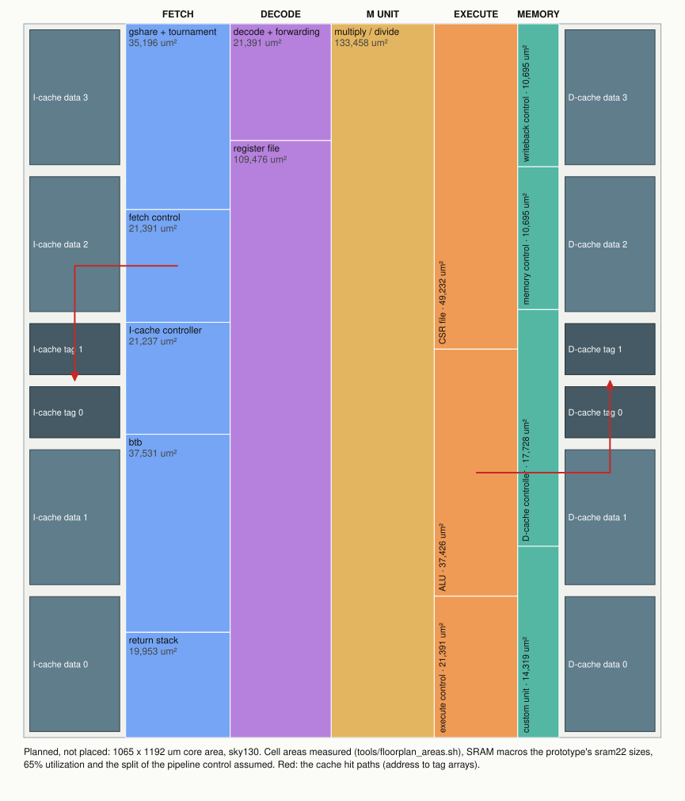

# Silicon: what this CPU looks like as a real chip

Everything on this page is real data: the final layout and reports of a 32-bit prototype of this pipeline
(SkyWater sky130), real sky130 standard-cell drawings, and open-source synthesis of
this repository's 64-bit RTL onto the sky130 high-density library.

## The whole die


A 3 mm x 3 mm die, but the logic covers only a few percent of it (cell density 2.8%): the rest is
filler and decoupling capacitors. The ten grey blocks at the lower left are SRAM macros from the
open-source sram22 generator: four data arrays and one tag array for each cache.

## The core


The placer groups cells that talk to each other. The register file (purple) is the largest block;
the pipeline logic (red) sits between it and the ALU (orange); the gshare predictor (teal) sits near
the fetch logic; the caches (blue and green) spread toward their SRAMs.

## The wiring


Five metal layers, alternating direction: met1 purple (inside cells), met2 blue (vertical), met3
green (horizontal), met4 orange (vertical, also over the SRAMs), met5 red (power and long wires).


These pictures are drawn by `tools/render_def.py` from the placed-and-routed DEF file: every
rectangle is one standard cell at its real position.

## Where the caches go: a planned floorplan for the 64-bit core

In the prototype above the ten SRAM macros sit together in the lower-left corner and the logic that uses them
sits near the middle of the die. Measured from its DEF file (`tools/floorplan.py`, Manhattan distance, because
wires run horizontally and vertically), the centre of the core's cells is about **2 mm** from each cache's tag
array:

| prototype (placed and routed), distance | instruction cache | data cache |
|---|---:|---:|
| core cells' centre to the tag array | 2,151 um | 1,996 um |
| cache controller's cells to its farthest SRAM | 768 um | 926 um |

The tag array is the one that matters most: every cycle, the address goes to the tags, the tags come back to
be compared, and the hit decides whether the pipeline stalls. A wire that long is slow even with a strong
driver. One `sky130_fd_sc_hd__buf_8` driving 2,151 um of metal 3 (its delay from the cell library at that
wire's capacitance, plus the wire's own resistance and capacitance from OpenROAD's sky130 values) takes
**655 ps** one way, before any logic. At the prototype's 26 ns clock that did not matter; at a few hundred
picoseconds it would be most of the cycle.



`make floorplan` draws a plan for this repository's 64-bit turbo core on the same process, with the caches
beside the stages that use them:

* **Measured:** every block's cell area (`tools/floorplan_areas.sh` synthesizes each one onto sky130 cells:
  register file 109,476 um2, multiply/divide unit 133,458, ALU 37,426, branch target buffer 37,531, and so
  on; the whole core 522,155), and the SRAM macros, which are the prototype's own `sram22` macros with their
  real sizes (150.4 x 225.26 um for 256 x 32 bits, 150.4 x 85.26 um for 64 x 32). Each cache's arrays come
  out at 32,768 data bits (4 macros) and 2,688 tag bits (one 64-entry macro per way, 2).
* **Assumed:** 65% of each logic region filled with cells (the rest is routing room), a 10 um keep-out around
  each macro, and the core's remaining logic (pipeline registers, forwarding, hazard and branch control,
  85,563 um2) spread over the stage columns in equal parts.
* **Arranged:** the stages left to right in pipeline order, the instruction cache's macros in a column on the
  FETCH side and the data cache's on the MEMORY side. The tag macros sit in the middle of each column, level
  with the block that sends them an address (the fetch logic and the ALU), with the data macros above and
  below. The multiply/divide unit, the largest block and not part of the one-cycle ALU loop, gets a column of
  its own, away from the data cache.

| planned (not placed), distance | instruction cache | data cache |
|---|---:|---:|
| address source (fetch logic, ALU) to the tag arrays | 364 um | 377 um |
| cache controller to its farthest SRAM | 650 um | 672 um |
| buf_8 + wire delay, address source to tags (prototype: 655 / 611 ps) | **184 ps** | **187 ps** |

The plan is 1,065 x 1,192 um of core area. It is a plan, not a layout: no placer or router has run on it
(that is the next step, with OpenROAD; see "Tools and flows" below), the distances are between block
centres, and the wire delays use one buffer and no repeaters. What it does show, with measured inputs, is the
principle: put each cache's tags next to the logic that addresses them, keep the large off-loop blocks out of
the way, and the address-to-tag distance shrinks 5 to 6 times and its delay about 3.5 times. Two consequences for a real chip:

* The cache RTL writes a whole 256-bit line in one cycle; a 32-bit-wide SRAM macro takes eight writes. A real
  refill streams the line in over eight cycles, which the bus delivers piece by piece anyway.
* On the 7 nm-class library the same core's logic is about 94 times smaller (4,022 um2 against 378,259 um2
  from `tools/timing.sh turbo`, both measured), so every distance shrinks by about the square root, 9.7 times.
  Wires get slower per micrometre at small nodes, so the arrangement matters more there, not less.

## Timing and area of the original chip


| metric | value |
|---|---|
| clock | 26 ns (38.5 MHz), setup slack +0.163 ns at ss / 100 C / 1.60 V |
| hold | slack +0.041 ns |
| cells | 15,753 standard cells, 10 SRAM macros |
| most used cells | AND2X1 2,177 · MX2X1 2,134 · DFFX1 1,720 |
| leakage | 0.030 mW |

The top of the cell list tells the story of a register-heavy design: thousands of 2-input
multiplexers (register file reads, forwarding) and 1,720 flip-flops (pipeline registers, register
file, counters).

## Standard cells up close

| | | |
|---|---|---|
|  |  |  |
|  |  |  |

Layer legend: nwell (beige) holds the PMOS transistors at the top; diffusion (green) is where
transistors form; polysilicon (red) is the gate; each red-over-green crossing is a transistor;
local interconnect (light blue) and metal 1 (purple) wire them up. Every cell in a library has the
same height, so cells can be placed side by side in rows sharing the power rails.

## This repository's 64-bit RTL on sky130

```bash
make synth     # downloads sv2v and the sky130_fd_sc_hd liberty file, then runs Yosys per module
```

| module | area (um2) | cells |
|---|---:|---:|
| RegisterFile (31 x 64-bit) | 109,461 | 6,971 |
| ALU (65-bit shared adder, shifters, W ops) | 14,703 | 2,684 |
| CSRFile (two 64-bit counters + registers) | 11,057 | 1,366 |
| BranchControl | 2,278 | 327 |
| GSharePredictor (4 bits) | 2,148 | 249 |
| LoadControl | 1,946 | 277 |
| BranchComparator | 1,545 | 240 |
| StoreControl | 1,025 | 147 |
| ControlUnit (+ALUdec) | 428 | 74 |
| ImmediateGenerator | 362 | 51 |

Typical corner, 25 C, 1.80 V library; area is the sum of cell areas before placement. The
`MultiplyDivideUnit` is left out: a single-cycle 64-bit divider is enormous, which is Lab 4.

GShare area versus history length:

| history bits | 2 | 4 | 6 | 8 | 10 |
|---|---:|---:|---:|---:|---:|
| area (um2) | 571 | 2,148 | 7,923 | 31,350 | 115,760 |

## Tools and flows

* Prototype: placed and routed with a commercial flow (Cadence Genus/Innovus); its layout and reports
  are in [`silicon/`](silicon).
* 7 nm-class timing: `tools/timing.sh performance asap7` maps the RTL onto the ASAP7 predictive library.
* Open source equivalent: OpenLane / OpenROAD-flow-scripts on the same sky130 PDK, after
  converting the SystemVerilog with sv2v.
