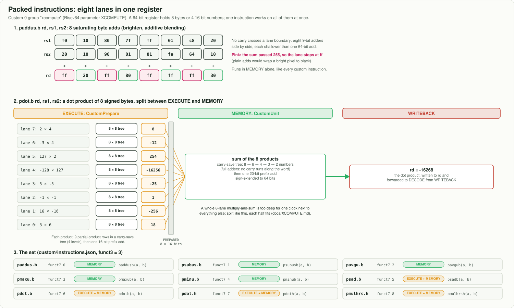
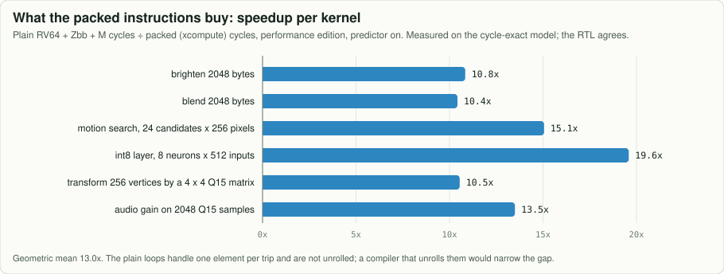

# Packed compute instructions (xcompute): eight bytes at a time

Graphics, video, audio and small neural networks spend most of their time on one kind of loop: the same
small operation on thousands of 8-bit or 16-bit numbers. A pixel channel is a byte, an audio sample is 16 bits,
and an int8 neural network stores its weights in signed bytes. A 64-bit register holds 8 bytes or 4 16-bit
numbers, but plain RISC-V instructions treat it as one number, so a loop over bytes loads, computes and stores
one byte per trip.

This page describes nine instructions that work on all the lanes of a register at once. This idea is called
SIMD (single instruction, multiple data). Doing it inside ordinary integer registers, without a separate vector
register file, is called SWAR (SIMD within a register). It is the same idea as x86's MMX (1997) and the RISC-V
P extension draft, sized to fit Sixfold's pipeline.

## The result

Every kernel runs twice in one program, once in plain RV64 (with Zbb and M) and once with the packed
instructions, and the program checks that both give the same answer (`a0 = 0`) and the expected checksum
(`a1`, computed by an independent Python model in [`tools/kernel_reference.py`](../tools/kernel_reference.py)).
The cycles are counted with `rdcycle` around each version. `make compute-bench` reproduces the table.

| kernel | instructions plain / packed | performance: cycles plain / packed | speedup | baseline | turbo | deep |
|---|---:|---:|---:|---:|---:|---:|
| brighten 2048 bytes (saturating add) (`25_pixel_blend`) | 20,484 / 2,308 | 25,616 / 2,363 | **10.8x** | 10.4x | 10.9x | 11.1x |
| blend 2048 bytes (rounded average) (`25_pixel_blend`) | 22,532 / 2,308 | 24,635 / 2,363 | **10.4x** | 10.4x | 10.5x | 12.1x |
| motion search, 24 candidates x 256 pixels (SAD) (`26_motion_search`) | 63,355 / 4,988 | 77,113 / 5,121 | **15.1x** | 15.1x | 15.1x | 16.7x |
| int8 layer, 8 neurons x 512 inputs (dot products) (`27_int8_dot`) | 32,840 / 3,162 | 66,539 / 3,397 | **19.6x** | 11.9x | 15.9x | 17.5x |
| transform 256 vertices by a 4 x 4 Q15 matrix (`28_fixed_point`) | 19,976 / 4,367 | 49,052 / 4,652 | **10.5x** | 4.3x | 7.0x | 9.9x |
| audio gain on 2048 Q15 samples (`28_fixed_point`) | 18,445 / 2,578 | 35,559 / 2,634 | **13.5x** | 8.0x | 11.2x | 12.5x |
| **geometric mean** | | | **13.0x** | 9.3x | 11.4x | 13.0x |

All measured (the cycle-exact model; the RTL of every build agrees cycle for cycle, `make test`). Two honest
caveats:

* The plain loops handle one element per trip and are not unrolled. A compiler that unrolls them, or packs
  bytes with shifts and masks (SWAR in plain code), would narrow the gap. Most of the speedup is the 8 (or 4)
  lanes; the rest is that one instruction replaces a compare-and-branch per element.
* The baseline build multiplies in one cycle, so its plain multiply loops are already fast and its speedups
  on the multiply kernels are smaller (4.3x for the vertex transform).

The clock does not get slower (see [Timing and area](#timing-and-area)), so the time saved is the same as
the cycles saved.

## The nine instructions

All are R-format on opcode custom-0 (`0001011`), `funct3 = 3`, `funct7` 0 to 8. They read rs1 and rs2 and
write rd, like `add`. "Byte lane i" is bits `8i+7 ... 8i`; "halfword lane i" is bits `16i+15 ... 16i`.

| mnemonic | funct7 | what it computes | used for |
|---|---:|---|---|
| `paddus.b` | 0 | per byte lane: `min(a + b, 255)`, unsigned | brightening, additive blending of light and particles, mixing 8-bit audio |
| `psubus.b` | 1 | per byte lane: `a > b ? a - b : 0` | darkening, shadow masks, image differences |
| `pavgu.b` | 2 | per byte lane: `(a + b + 1) >> 1`, computed in 9 bits so it cannot overflow | 50% blends, halving an image for a mipmap, motion compensation |
| `pmaxu.b` | 3 | per byte lane: the larger, unsigned | image dilation, the brightest sample, per-channel clamps |
| `pminu.b` | 4 | per byte lane: the smaller, unsigned | image erosion, per-channel clamps |
| `psad.b` | 5 | one 64-bit number: the sum over the 8 lanes of `\|a - b\|`, unsigned | motion search in video encoders, template matching |
| `pdot.b` | 6 | one 64-bit number: the sum over the 8 lanes of `a * b`, signed bytes | int8 neural-network layers, 8-tap filters, convolution |
| `pdot.h` | 7 | one 64-bit number: the sum over the 4 lanes of `a * b`, signed 16-bit | fixed-point vectors and matrices for 3D, audio filters |
| `pmulhrs.h` | 8 | per halfword lane: `(a * b + 0x4000) >> 15`, signed; `-32768 * -32768` gives `32767` | Q15 fixed-point gain, mixing, lighting |

Q15 is a fixed-point format: a signed 16-bit number `n` stands for `n / 32768`, so it covers -1 to just
under 1. Multiplying two Q15 numbers gives a Q30 product; adding `0x4000` (half of `2^15`) and shifting right
by 15 rounds it back to Q15. The only product that does not fit is `-1 x -1 = +1`, which saturates to the
largest Q15 value. Saturating means stopping at the largest or smallest value instead of wrapping around: a
plain byte add turns a bright pixel (`0xf0 + 0x20`) into a dark one (`0x10`), a saturating one keeps it white
(`0xff`).

The definitions live in [`custom/instructions.json`](../custom/instructions.json) as one expression each
(`paddusb(a, b)` and so on). The functions are part of the custom-instruction language
([`model/custom.js`](../model/custom.js)), so you can use them in your own instructions too, in the
[instruction workshop](../web/custom.html).

## How they fit the pipeline

They are custom instructions, so they follow the rules in [CUSTOM_INSTRUCTIONS.md](CUSTOM_INSTRUCTIONS.md):
decoded in DECODE (`CustomDecode`, one select bit each), carried through EXECUTE, computed in MEMORY
(`CustomUnit`), written in WRITEBACK. An instruction that needs the result right away waits 2 cycles, one with
one instruction in between waits 1. These waits are counted with the load stalls (L) in the cycle equation, so
the equation does not change. The kernels put independent work between a result and its use (in `27_int8_dot`,
two partial sums take turns), so they rarely wait.

The five lane operations (`paddus.b` ... `pminu.b`) are eight 9-bit adders or comparators side by side. No carry
crosses a lane boundary, so they are shallower than one 64-bit add and fit MEMORY easily.

The four reductions do not fit one stage: eight 8 x 8 multiplies and a sum of eight products is more logic
than one clock allows next to everything else. The generator splits them, the way it already splits
`hamming`:

* **EXECUTE** (`CustomPrepare`): the lane products, or the 8 byte differences for `psad.b`. Each product is a
  carry-save tree of partial-product rows. For `pdot.h` and `pmulhrs.h`, a 16 x 16 product's tree and its final
  add did not fit one stage together, so the product stays in carry-save form, two numbers per lane, and
  crosses the stage boundary like that.
* **MEMORY** (`CustomUnit`): the sum of the products, as one carry-save tree, then one prefix adder.
* In between: the register `MEMORY_CUSTOM_PREPARED`, **272 bits** wide (4 lanes x 2 x 34 bits for `pdot.h`,
  the widest). Each instruction's first half is chosen by the select bits inside `CustomPrepare`, so the four
  split instructions share the same 272 flip-flops.

A carry-save tree adds many numbers without waiting for carries: each full adder takes three bits of the same
weight and gives a sum bit and a carry bit, so a layer turns three numbers into two. Eight numbers become two
in four layers, and only the last addition has to propagate a carry across the word.

## Turning them on: the XCOMPUTE parameter

The packed set is a group (`"group": "xcompute"` in the JSON). The generator gates their select bits with a
parameter, so a build without them has none of their decode and their results are never chosen.

| where | default | set by |
|---|---|---|
| `Riscv64` parameter `XCOMPUTE` | **0 (off)** | so a design that instantiates `Riscv64` directly, such as a system pinned to an older Sixfold, keeps its exact behavior |
| `Riscv64_top` | 0 (off), passed through to `Riscv64` | the same reason |
| the FPGA system, the testbench, `tools/timing.sh` | 1 (on) | every build in this repository |
| deep edition (`Riscv64Deep`) | 1 (on) | |
| the model (`model/core.js`, `model/deep.js`) | on in every build config | `xcompute: false` turns it off |

With `XCOMPUTE = 0`, each packed encoding writes 0 to rd (the same as any unused custom-0 slot).
[`tests/xcompute_off.s`](../tests/xcompute_off.s) checks exactly that, on a fifth test configuration, `xoff`
(the performance build compiled with `-DXCOMPUTE_OFF`, against the model with the group off).

Note for designs that embed Sixfold as a submodule: `CustomPrepare` gained a `SELECT` port and
`PREPARED` is now 272 bits. With the default `XCOMPUTE = 0` the core behaves as before, but a design that
instantiates `CustomPrepare` itself, or keeps test vectors of `Custom_Unit.sv`, should move its submodule and
its vectors together.

## Timing and area

Measured with `tools/timing.sh` (logic only, no wires; the same flow as [PERFORMANCE.md](PERFORMANCE.md)).
ABC, the logic optimizer, gives noticeably different results for nearly the same netlist; on the turbo build
it moved by more than 40% between runs. Read the delays below as "no slower", not as "faster".

| build | without the packed set | with it | slowest path with it starts at |
|---|---:|---:|---|
| performance, SkyWater 130 nm | 4,415 ps, 327,007 µm² | 3,853 ps, 414,031 µm² | `MEMORY_CUSTOM_PREPARED` (the `pdot.h` MEMORY half) |
| turbo, SkyWater 130 nm | 4,703 ps, 384,811 µm² | 3,789 ps, 470,171 µm² | `MEMORY_CUSTOM_PREPARED` |
| performance, ASAP7 7 nm-class | 537 ps, 3,395 µm² | 526 ps, 4,534 µm² | `MEMORY_CUSTOM_PREPARED` |
| deep edition, ASAP7 (the custom chain is a black box, see below) | 381 to 401 ps (FENCE.I runs) | 370 ps | the data cache's refill logic, not the custom unit |

So the packed set costs about a quarter more logic area (+27% on the performance build at 130 nm) and no
clock. The slowest path of the performance and turbo builds now starts in the custom unit, which means the
custom logic is level with the ALU loop that was the slowest path before: there is no room left to add a
deeper instruction without slowing the clock.

Each half, measured alone on SkyWater 130 nm (inputs to output), against one 64-bit prefix add (1,651 ps):

| function | EXECUTE half | MEMORY half |
|---|---:|---:|
| a lane operation (`paddus.b` ...) | | about 990 ps |
| `psad.b` | 1,374 ps | 2,571 ps |
| `pdot.b` | 2,789 ps | 2,707 ps |
| `pdot.h` | 2,738 ps | 3,014 ps |
| `pmulhrs.h` | 2,406 ps | 1,412 ps |

These are the numbers behind the workshop's depth meter (`DEPTH` in `model/custom.js`), and its budget is
now 1.85 adder delays: `pdot.h`'s MEMORY half is 1.83, the deepest that has been measured inside the core
without slowing it.

In the deep edition the custom logic has three cycles (X4, M1, M2) to settle, and `DeepCustomChain` is timed
alone: 906 ps on ASAP7 with the packed set (505 ps before), against a budget of three 466 ps cycles minus one
flip-flop overhead, 3 x 466 - 64 = 1,334 ps. It fits.

## How it is tested

* [`tests/xcompute_selfcheck.s`](../tests/xcompute_selfcheck.s): 504 cases, every instruction on lane edge
  values (0, 1, 127, 128, 255, -1 x -1, -32768 x -32768, ...), forwarding right after, chained results,
  operands from loads, `rd = rs1`, and results used by branches. The expected values come from an independent
  Python definition of each lane ([`tools/gen_selfcheck.py`](../tools/gen_selfcheck.py)), not from the model.
* [`tests/xcompute_off.s`](../tests/xcompute_off.s): with `XCOMPUTE = 0`, every packed encoding writes 0.
* `make custom-check`: random custom instructions run through both halves of the RTL against the model; it
  now runs enough rounds that every function, including the nine packed ones, is used, and draws operands from
  lane edge values.
* The four kernel programs (25 to 28) self-check plain against packed and against Python's checksum.
* All of them on every build, predictor on and off, RTL against the model on every clock cycle (`make test`).

## What was not added, and why

* **Zicond** (`czero.eqz`, `czero.nez`: a branch-free select). It is a ratified RISC-V extension and cheap
  (a 64-bit AND), but on Sixfold it would have to sit in the ALU, and the ALU loop is the slowest path in all
  four builds. As a custom instruction in MEMORY its result would come two cycles late, which undoes the point
  of avoiding a branch. Worth adding when the ALU loop has room.
* **Hardware loops** (a loop counter that the fetch stage counts down, so the loop needs no branch). They save
  one or two instructions per trip, but need new state and changes in FETCH1, and Sixfold's predictor already
  predicts loop branches almost perfectly.
* **A three-operand multiply-add** (`rd = rd + rs1 * rs2`). It would need a third register read port and a
  third forwarding path; the kernels get the same effect from `pdot` plus an `add`.
* **Zbc** (carry-less multiply, for CRC and GCM encryption). Useful, but for checksums and cryptography rather
  than the graphics and compute loops asked for here.
* **The V extension** (vectors). The real answer for long arrays: a separate register file of long vectors.
  It is far bigger than everything on this page, and a project of its own.

## Further reading

* [CUSTOM_INSTRUCTIONS.md](CUSTOM_INSTRUCTIONS.md): how custom instructions are generated and checked.
* [Chapter 15 of the learning path](learn/15_packed_compute.md): the same ideas, step by step.
* The RISC-V P extension draft (packed SIMD in integer registers) and Intel's MMX and SSE2 manuals
  (`PADDUSB`, `PAVGB`, `PSADBW`, `PMADDWD`, `PMULHRSW`): the same operations on other machines.
