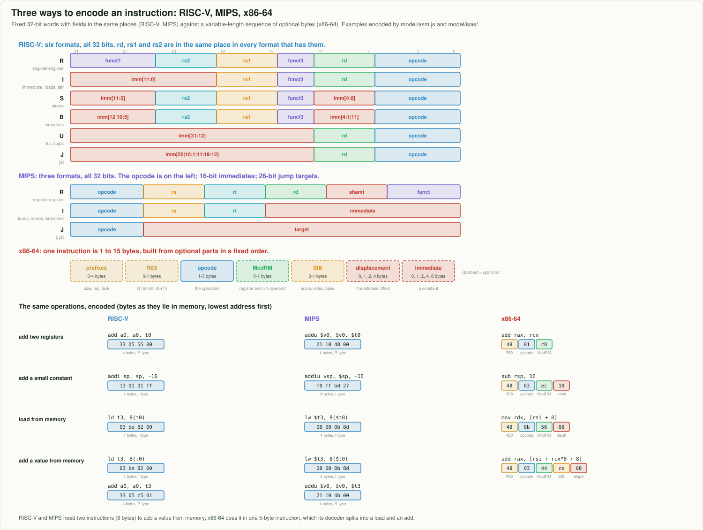
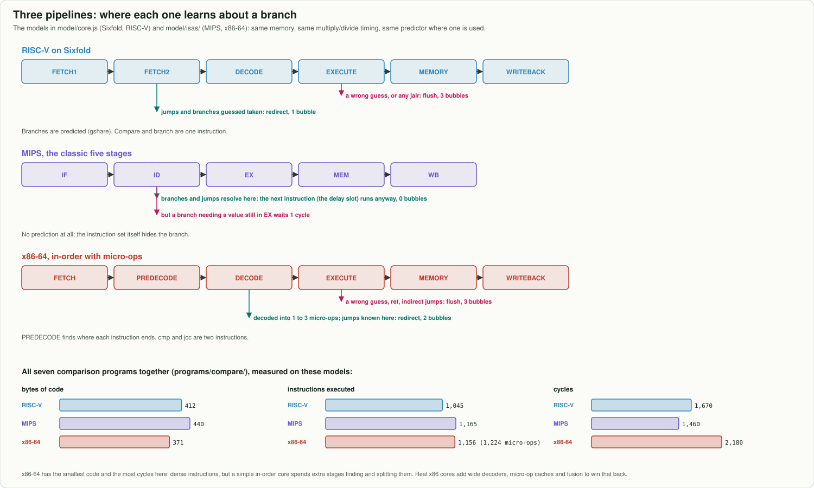

# 10. Three architectures: the same program on RISC-V, MIPS and x86-64

Everything so far was about one instruction set architecture (ISA): RISC-V. An ISA is the contract
between software and hardware: which instructions exist, how they are encoded in bits, which registers
there are. The pipeline behind it (the microarchitecture) is a separate choice. This chapter puts one
small program in three ISAs side by side, so you can see which differences come from the contract and
which from the pipeline.

Open [the three-architecture lab](../../web/isa.html) and keep it next to this page.

## The same loop, three times

Adding 1 to 100 (`programs/compare/*/sum_to_100.s`), the loop only:

```text
RISC-V                         MIPS                              x86-64
loop:                          loop:                             loop:
  add  a0, a0, t0                addu  $v0, $v0, $t0               add  rax, rcx
  addi t0, t0, 1                 bne   $t0, $t1, loop              inc  rcx
  ble  t0, t1, loop              addiu $t0, $t0, 1   # delay slot  cmp  rcx, 100
                                                                   jle  loop
```

Three things to notice:

1. **RISC-V compares inside the branch.** `ble t0, t1, loop` reads two registers and branches. There is
   no flags register at all.
2. **MIPS runs the instruction after a branch no matter what.** That slot is the *branch delay slot*.
   The programmer (or the compiler) moves useful work into it: here, the `i++`. MIPS also only has `beq`
   and `bne` for two registers, so `blt` needs an extra `slt` first.
3. **x86-64 compares, then jumps.** `cmp` sets the flags register; `jle` reads it. Every loop is one
   instruction longer. In exchange `cmp rcx, 100` holds its constant in one byte.

## Bits



RISC-V and MIPS instructions are always 4 bytes, so the hardware knows where the next one starts before
it has looked at this one. x86-64 instructions are 1 to 15 bytes, built from optional parts: a REX byte
(register extension) to say "64-bit" or reach registers 8 to 15, the opcode, a ModRM byte (mode,
register, register/memory) naming the operands, sometimes a SIB byte (scale, index, base) for addresses
like `[rsi + rcx*8 + 8]`, then a displacement and an immediate.

Click any row of the lab's **Machine code** listing: it shows each field or byte with its name. Try to
predict the bytes of `add rax, rcx` before you look (`48 01 c8`: REX.W, the opcode for "add register to
register/memory", and ModRM `11 001 000` = register mode, rcx, rax).

## Pipelines



Each model follows the classic design for its architecture, with the same memory, multiply/divide unit
and branch predictor:

* **RISC-V on Sixfold** (6 stages): branches are predicted. A branch guessed taken costs 1 bubble (found
  in FETCH2); a wrong guess costs 3 (found in EXECUTE).
* **MIPS** (5 stages, IF ID EX MEM WB): branches are decided in ID. Thanks to the delay slot the
  instruction already fetched behind the branch is useful, so a branch costs nothing. But a branch whose
  register is still being computed in EX must wait one cycle: no prediction means no guessing ahead.
* **x86-64** (6 stages): PREDECODE finds each instruction's length; DECODE splits it into *micro-ops*,
  simple RISC-like operations (`add rax, [rsi + 8]` becomes "load" then "add"). Jumps are found in
  DECODE: 2 bubbles.

Each pipeline has a cycle equation, just like Sixfold's in chapter 6. For sum_to_100:

| | equation | cycles |
|---|---|---|
| RISC-V | 304 instructions + 5 fill + 3 flush + 99 redirect | 411 |
| MIPS | 304 instructions + 4 fill | 308 |
| x86-64 | 403 micro-ops + 5 fill + 3 flush + 198 redirect | 609 |

MIPS wins this loop outright: its delay slot hides the branch completely. (Sixfold's performance build would
catch up: its Branch Target Buffer remembers where taken branches go, so FETCH1 redirects with no
bubble at all. The comparison uses the baseline build so that no model gets a predictor the others lack.) x86-64 pays twice: one more
instruction per pass, and 2 bubbles per taken jump instead of 1.

## Try it

1. In the lab, pick `sum_to_100` and MIPS. Step until the `bne` reaches ID and watch the `addiu` behind
   it: it is fetched, and it runs, even on the last pass when the branch is not taken.
2. Switch to x86-64 and find a cycle where DECODE holds the same instruction twice. Which instruction is
   it, and what are its micro-ops? (Try `factorial_recursive`: `call`, `push`, `ret`.)
3. Open the **Edit source** tab on MIPS, move the `addiu` above the `bne` and put a `nop` in the slot.
   Assemble, run to the end: how many cycles now, and why is the result different?
4. Compare the "bytes of code" row across all seven programs. Why is x86-64 smallest on
   `factorial_recursive` but not on `gcd`?

## Why RISC-V has no delay slot

The delay slot was perfect for the 5-stage pipeline MIPS was designed around in 1985: one instruction
was in flight behind every branch. A deeper pipeline has several, and a superscalar one fetches many per
cycle; one slot no longer hides anything, yet every MIPS processor had to keep honouring it forever,
because old programs depend on it. RISC-V's designers (who had built MIPS-style machines) left it out
and rely on branch prediction instead, which keeps working as pipelines change. An ISA is a contract
for decades: features that help one pipeline become a cost for every later one.

x86-64 shows the opposite strategy: keep the old, dense, variable-length instructions for compatibility,
and translate them into micro-ops inside the processor. Real x86 processors then add several decoders,
a cache of already-decoded micro-ops, and **macro-fusion** (decoding `cmp` + `jle` into one micro-op).
You can add that last one yourself: [EXPERIMENTS.md, Lab 24](../EXPERIMENTS.md#lab-24-teach-the-x86-64-model-a-real-processors-tricks).

More detail and all seven programs: [ISA_COMPARISON.md](../ISA_COMPARISON.md).
