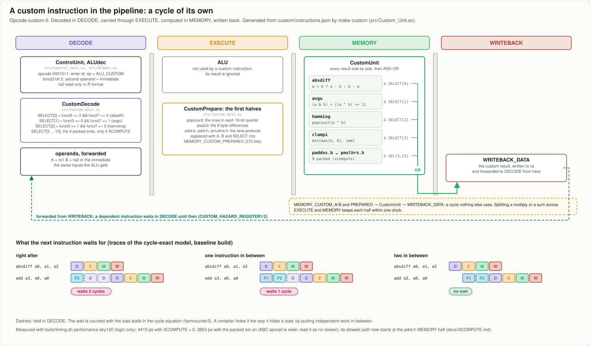

# 11. Your own instructions: extending the instruction set

Chapter 10 compared three instruction sets that were each fixed by somebody else. This chapter is
about changing one. RISC-V was designed for that: anyone may add instructions without asking
permission, as long as they use the space the specification sets aside for it.

Open the [instruction workshop](../../web/custom.html) next to this page.

## Where new instructions go

Bits 6:0 of every instruction are the major opcode. RISC-V uses most of the 32 combinations whose low
two bits are `11`, and reserves four, `custom-0` to `custom-3`, that no official extension will ever
take. Sixfold uses `custom-0` (`0001011`). Inside it, the instruction looks exactly like an ordinary
R-type or I-type instruction, so the parts of the processor that read registers, choose operands and
forward values do not change at all:

```text
R:  funct7  rs2  rs1  funct3  rd  0001011      absdiff a0, a1, a2
I:  imm[11:0]    rs1  funct3  rd  0001011      clampi  a0, a1, 255
```

Sixfold's decoder needs one decision to support both shapes: funct3 bit 2. funct3 0 to 3 means R format
(read rs2), 4 to 7 means I format (use the immediate). That rule lives in `src/Control_Unit.sv` and is
the same for every instruction you will ever add.

## Design one: saturating add

When you add two brightness values and the result is more than the largest number, plain `add` wraps
around to a small number: a bright pixel turns black. A saturating add sticks at the maximum instead.
In plain RV64I that is three instructions and a branch:

```text
    add  t0, a1, a2
    bgeu t0, a1, ok          # no wrap-around: the sum is not smaller than an input
    li   t0, -1              # wrapped: use the largest unsigned number
ok:
```

As a custom instruction it is one expression. In the workshop choose **New instruction**, name it
`satadd`, and write:

```text
a + b < a ? -1 : a + b
```

Try it with `a = -1` (the largest unsigned number) and `b = 5`: the result stays `-1`. The panels show
what you just made:

* **Its encoding.** The workshop picked a free funct3 and funct7, so `satadd a0, a1, a2` is a real 32-bit
  word, and the disassembler already reads it back.
* **What the hardware needs.** Two adders (the two `a + b` are the same sum, and a synthesis tool would
  share them), a comparator and a 64-bit multiplexer: about the size of the ALU's add path.
* **The SystemVerilog.** One term of an AND-OR, kept when this instruction's select bit is set:
  `| ({64{SELECT[4]}} & (((A + B) < A) ? 64'hffffffffffffffff : (A + B)))`

## A cycle of its own

Run the test program the workshop writes. It uses the result in the very next instruction, and the
statistics show two cycles spent waiting. That is deliberate. A clock cycle must be long enough for the
slowest logic between two pipeline registers, and Sixfold's EXECUTE stage is already full (chapter 7
shows its critical path). If your logic went there, the whole processor would have to slow down to wait
for it. So your instruction's operands are chosen in DECODE like any other, carried through EXECUTE, and
the custom logic runs in MEMORY, a cycle it shares with nothing. The result is written back the cycle
after:



```text
cycle          1          2          3          4
satadd a0     EXECUTE    MEMORY     WRITEBACK
addi a3, a0   DECODE     DECODE     DECODE     EXECUTE    <- held two cycles, then a0 comes from WRITEBACK
```

Put one independent instruction between the producer and the consumer and the wait drops to one cycle;
two, and it disappears. Compilers schedule code around loads in exactly this way (chapter 4).

The workshop's **Longest path** meter estimates whether your expression fits in that cycle, in "adder
delays". `satadd` written as `a + b < a ? -1 : a + b` adds and then compares: two steps one after the
other, about 2.2 adder delays, too long. Written as `a > ~b ? -1 : a + b` it compares the inputs while the
adder works (a + b overflows exactly when a > ~b): 1.2, it fits. Same function, half the depth.
[CUSTOM_INSTRUCTIONS.md](../CUSTOM_INSTRUCTIONS.md#what-fits-in-a-cycle) shows the measurements behind
the meter, including how Sixfold's own `hamming` had to be rebuilt as a carry-save tree to fit.

## Measure it

An instruction must earn its encoding. `programs/23_custom_instructions.s` measures Sixfold's four
examples with `rdcycle`, the plain way and the custom way:

| task | plain RV64I | custom |
|---|---|---|
| sum of absolute differences, 8 pairs | 179 cycles | 83 cycles (`absdiff`) |
| Hamming distance of two words | 181 cycles | 13 cycles (`hamming`) |

The Hamming distance gains most because the plain version is a loop over the differing bits, and its
branch is hard to predict. `absdiff` gains because a compare-and-branch per element disappears.

## Put it in the hardware

In the workshop press **Download JSON** (JavaScript Object Notation, a plain text format) and save the file as `custom/instructions.json`, then:

```bash
make custom        # writes src/Custom_Unit.sv and model/custom_spec.js
make test          # the RTL against the model on every clock cycle, every program
make custom-check  # random instructions through the same compiler, RTL against model
```

`make test` runs program 23 (and your own programs) on the SystemVerilog and on the model and compares
them every cycle. The two were generated from one expression by two different translators, so if they
agree on random and edge-case operands you have good evidence both are right. `make custom-check` adds
60 random instructions using every operator and function.

## Try it

1. Make `satadd` as above, then change it to a *signed* saturating add. What should happen when two
   negative numbers add up to something below the smallest signed number? (Hint: `slt`.)
2. Add `czero.eqz` from the ideas list. RISC-V standardised exactly this instruction in 2023 as the
   Zicond extension. Rewrite a branch in `programs/05_fibonacci.s` without it and with it.
3. Add `dot2b`, a two-byte dot product. The workshop warns that it needs two multipliers. Why would a
   real processor give it more than one cycle?
4. Use a custom result as a branch operand, a store's data and a load's address. Which of those wait?
   Check your answer in the pipeline lab (**Step through it in the pipeline lab**): all three wait the same
   way, because every forwarded value comes through DECODE.

More: [CUSTOM_INSTRUCTIONS.md](../CUSTOM_INSTRUCTIONS.md) (the whole language and how it reaches the
hardware), and [EXPERIMENTS.md, Lab 25](../EXPERIMENTS.md#lab-25-design-an-instruction-for-a-real-workload).
