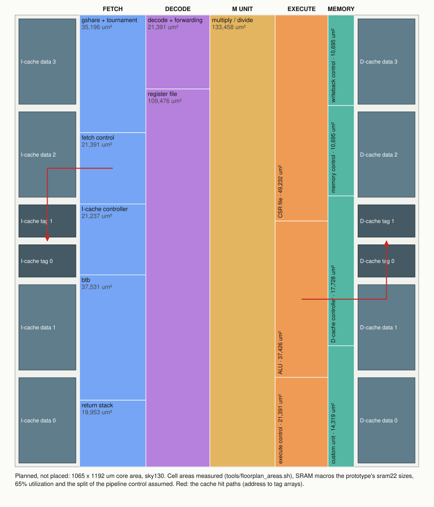
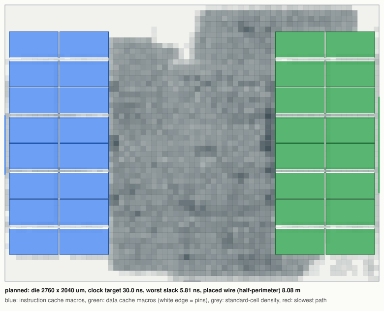

# 13. Trading cycles for clock, and where the caches go

[Chapter 6](06_performance.md) gave the iron law: run time = instructions x CPI x clock period. Every
earlier chapter worked on CPI (cycles per instruction). This one works on the other lever, the clock
period, using the turbo build (`CONFIG=turbo`), and then on something the RTL (register-transfer level
code) does not show at all: where each block sits on the chip.

## Find the slowest path first

The clock period is set by the single slowest path between two flip-flops. `tools/timing.sh` maps the
core onto real standard cells and reports that one path. To see the next ten as well, run:

```bash
tools/timing.sh turbo asap7                     # the whole core on the ASAP7 7 nm-class library
python3 tools/path_report.py turbo asap7 --top=10
python3 tools/path_report.py turbo asap7 --trace=icache_addr
```

`path_report.py` lists the slowest path into every group of registers. When they all end near the same
number, there is no single culprit left: that is a "wall", and each path needs its own fix.

## Three ways to shorten a path

**Decide earlier.** A decision that depends only on the instruction can be made a stage before it is
needed and stored in a flip-flop. `FAST_ALU` decodes the ALU operation in DECODE into one select line per
result (`alu_select` in [`src/Riscv64.sv`](../../src/Riscv64.sv)), so the result multiplexer in EXECUTE never
waits for a comparison of operation codes. `FAST_STALL` does the same for the hazard checks: it decodes the
FETCH2 instruction one cycle early and compares its register numbers ahead of time, so `LOAD_STALL` (which
holds hundreds of front-end flip-flops) comes almost straight from flip-flops. `FAST_LOAD_ALIGN` decides in
EXECUTE which byte of the loaded doubleword lands where, so in MEMORY a load's data passes one AND-OR on its
way to forwarding.

**Do it later.** Work that does not fit can move to the next stage, at the price of a bubble when an
instruction needs the result at once. `clz`, `ctz`, `min` and `max` now finish in MEMORY, like `cpop`.
A custom instruction's `popcount` counts its ones in four quarters in EXECUTE and adds the four in MEMORY.
`LATE_BRANCH_RESOLVE` stores a branch's outcome and flushes one cycle later, from MEMORY. A wrong guess then
costs 4 bubbles instead of 3, so the cycle equation gains a term, B, and the hardware counts it in
`hpmcounter10`:

```text
cycles = N + 5 + L + 3F + R + K + I + D + X + B
```

**Do both at once.** FETCH2 used to pick the branch or the jump immediate and then add it to the PC.
`FAST_FETCH_TARGET` adds both in two adders side by side and picks a finished sum: more area, a shorter path.

## The scoreboard

All four together, measured with the same flow ([PERFORMANCE.md](../PERFORMANCE.md#the-clock-four-changes-that-move-work-off-the-longest-paths)):

| | 7 nm-class | 130 nm | CPI over all 32 programs |
|---|---:|---:|---:|
| turbo before | 533 ps | 3882 ps | 1.914 |
| turbo after | 485 ps | 3629 ps | 1.930 |

CPI went up 0.8% and the clock period went down 9%: about 8% less run time. That is the trade every fast
processor makes, many times over.

Then the wall went flat. Two more changes took their own paths out of the top (the custom unit's write data
from 521 to 447 ps), yet the whole core only moved to 471 ps, inside the flow's spread, because the ALU loop and
the multiply/divide steps sit at the same height. Cutting forwarding from EXECUTE alone left the clock at 473 ps
and cost 14.6% more cycles; a shorter multiply step alone gave 469 ps; both together gave 425 ps for at least
15% more cycles ([PERFORMANCE.md](../PERFORMANCE.md#two-more-and-two-experiments-that-did-not-pay)). When the
wall is flat, the next gain is a deeper pipeline, not one more path. How far it can go with a single-issue pipeline is measured in
[PERFORMANCE.md, "The floor, measured"](../PERFORMANCE.md#the-floor-measured-the-alu-bypass-loop).

## Wires: where the caches go

At a few hundred picoseconds per cycle, a wire a few millimetres long is a large part of the cycle. The
cache's hit check sends an address to the tag arrays and waits for them to answer, every cycle, so the tags
belong right next to the logic that addresses them. In the 32-bit prototype they sat about 2 mm away.
`make floorplan` draws a plan for the 64-bit core with every block's measured area and real SRAM macro sizes,
the instruction cache beside FETCH and the data cache beside the ALU, and computes the delay of those wires
for both arrangements ([SILICON.md](../SILICON.md#where-the-caches-go-a-planned-floorplan-for-the-64-bit-core)).



A plan is arithmetic; a placer and router are the test. With `SRAM_CACHES = 1` the caches keep their lines in
32 real SRAM macros, read at the very clock edge the core already loads the cache's answer into a register, so
not one cycle changes (`make test-sram` checks it against the model). `make asic-corner`, `asic-planned` and
`asic-auto` then place and route the core with OpenROAD three ways, the macros in one corner, beside each
cache's memory port, or wherever OpenROAD's macro placer puts them
([SILICON.md](../SILICON.md#placing-the-cache-srams-for-real-openroad)). The lesson of the measurements is
that "close" has two sides. Beside its port, each cache needed the fewest repeater buffers and the shortest
wires to its SRAMs. But the macros' pin edges face each other across narrow channels, and with two caches
on two edges the router found far more of those channels full than with one block in a corner. A good floorplan
leaves room for the wires as well as making them short.



## Try it

* In `tools/timing.sh`, remove `-set FAST_STALL 1` from the turbo parameters, run the timing again, and
  look for `LOAD_STALL`'s enables in `path_report.py`'s list.
* Run `node tools/rv.mjs run programs/04_branch_penalty.s --config=turbo --bp=off` and the same with
  `--config=performance`. How many cycles does B add, and why is it one per wrong guess?
* In `tools/timing.sh`, add `-set FAST_LOAD_ALIGN 0` after the turbo parameters and compare
  `path_report.py`'s `alu.B` line with and without it.
* In `tools/floorplan.py`, swap the M UNIT and EXECUTE columns and run `make floorplan`. What happens to
  the ALU-to-tag distance?

* Run `MACRO_CHANNEL_UM=60 asic/flow.sh planned 30 place` (it needs Yosys, OpenROAD and the sky130 PDK) and
  compare its `build/asic/planned/metrics_placed.json` with the 24 um channels' numbers in
  [SILICON.md](../SILICON.md#what-was-measured).

Back to the [learning path](README.md).
