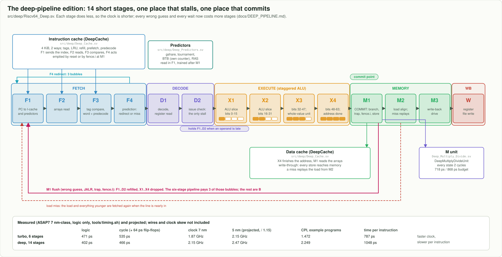

# 14. A deeper pipeline: more stages, a faster clock, and what it costs

[Chapter 13](13_clock_and_floorplan.md) ended at a flat wall: in the six-stage turbo build, many paths sit at
the same height, so shortening one more path no longer moves the clock. The next step is the one every fast
processor takes: cut the work into more, shorter stages. This chapter follows that step in the deep-pipeline
edition (14 stages, in [`src/deep/`](../../src/deep)) and measures what it buys and what it costs. The full
design and every number are in [DEEP_PIPELINE.md](../DEEP_PIPELINE.md).

## Fourteen stages

```text
F1 F2 F3 F4 D1 D2 | X1 X2 X3 X4 | M1 M2 M3 | W
```



FETCH becomes four stages (send the address, read the arrays, compare the tags, act on the prediction),
DECODE becomes two (decode, then decide whether the instruction may go), EXECUTE becomes four and MEMORY
three. Each stage does less, so the clock period can be shorter.

Two rules keep the deep pipeline simple:

* **Only D2 stalls.** Everything behind it moves one stage per cycle, always. If an operand will not be ready
  in time, the instruction waits in D2 before it starts, never in the middle.
* **M1 is the commit point.** Branches are checked, traps are taken and stores are written in M1. A load that
  misses the data cache does not stop the pipeline: it and everything after it are fetched again ("replayed")
  when the line is nearly in.

## Cutting the adder into slices

An add cannot simply be cut in four: a dependent add would then wait three cycles for the result. Instead the
ALU is **staggered**: bits 0 to 15 in X1, 16 to 31 in X2, and so on, passing the carry along. A dependent add
also starts with its low bits, which its producer made one cycle earlier, so adds still run back to back at one
per cycle. [`tools/clock_floor/staggered_alu.sv`](../../tools/clock_floor/staggered_alu.sv) shows the idea in
one small file.

Instructions that need the whole value at once (a shift, a store's data, a multiply's operands) cannot use the
low slice early, so they wait in D2 until the whole value exists. The table at the top of
[`model/deep.js`](../../model/deep.js) lists, for every producer, the stage where its result is complete.

## The result

| | turbo (6 stages) | deep (14 stages) |
|---|---:|---:|
| logic on the slowest path, 7 nm-class (measured) | 471 ps | 402 ps |
| clock at 7 nm | 1.87 GHz | 2.15 GHz |
| CPI on the example programs (measured) | 1.472 | 2.249 |
| time per instruction | 787 ps | 1048 ps |

The clock went up 15%, but the CPI went up 53%, so each instruction takes about a third longer. Use the iron
law from [chapter 6](06_performance.md) to check it: 2.249 x 466 ps = 1048 ps, and 1.472 x 535 ps = 787 ps.

Where did the cycles go? Every wrong branch guess now throws away 10 stages of work instead of 3. Every
dependent instruction that needs a whole value waits longer. And the multiply/divide unit, whose every step
now takes two short cycles, is about a third of the cycles on its own. A real 5 GHz processor hides those
waits with out-of-order execution: while one instruction waits, independent ones behind it run. An in-order
pipeline like this one cannot.

## Run it

```bash
make deep-check                 # every program: deep CPI against turbo, and what made each instruction wait
node tools/test.mjs --config=deep   # the deep RTL against its model, every cycle
tools/timing.sh deep asap7      # the slowest path of the deep core
```

## Try it

* In `make deep-check`'s output, find the program where the deep edition comes closest to the turbo build
  (`21_timer_interrupts`). Why does a program that mostly waits for the timer hide the pipeline's depth?
* In `22_multitasking`, the column `mdu` counts the cycles spent waiting for multiply/divide. What fraction of
  the program's cycles is it?
* In [`model/deep.js`](../../model/deep.js), `DEEP_CONFIG.missLatency` is 12. Why 12 and not 10, like the
  turbo build? (Hint: compare 12 x 466 ps with 10 x 535 ps.)

Back to the [learning path](README.md).
